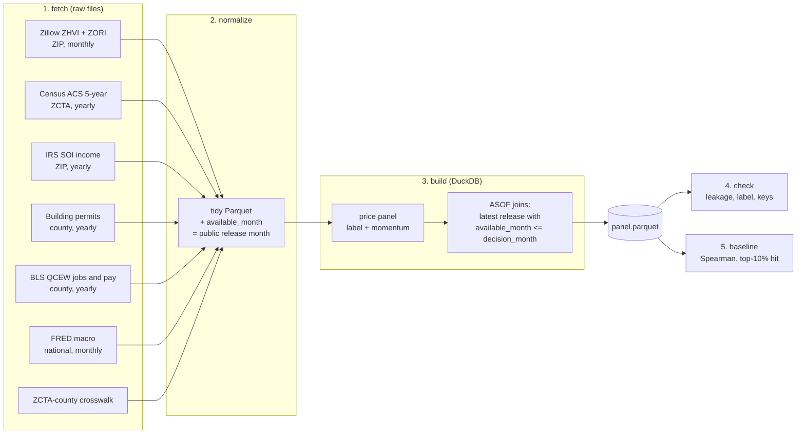

# housing-model

Build a ZIP-by-month training table for US home price growth, from free public data.
Then score simple baselines that a real model must beat.

- **One row:** one ZIP code in one month (2012 to now).
- **Target:** 12-month forward growth of the Zillow Home Value Index (ZHVI), minus the
  mean of the ZIP's metro in the same month. This is a ranking target: "which ZIPs grow
  faster than their metro next year".
- **Scale:** about 26,000 ZIPs × about 175 months ≈ 4.5 million rows.
  A full-scale test on synthetic data took about 35 seconds to build and used about 0.4 GB
  on disk (on a 4-core machine).

## How it works



### Release dates (the main rule)

A model in month t+1 can only see data that was public in month t+1. So every feature
is joined by its release month, not by its data month.

```
row month t ──► decision_month = t + 1   (ZHVI for t is published mid t+1)
                     │
                     ├─ ZHVI history up to t          (momentum features)
                     ├─ ACS vintage released <= t+1   (for example 2020 vintage: 2022-03)
                     ├─ IRS tax year released <= t+1  (about 30 months after the tax year)
                     ├─ permits, jobs for years released <= t+1
                     └─ FRED month m, after its lag
label = log ZHVI(t+12) - log ZHVI(t)
```

## Run it on your Mac

You need about 3 GB of free disk and an internet connection. The IRS files are the
largest download. The build itself takes about 1 minute.

1. Install Python 3.12 (skip if you have Python 3.10 or newer):

   ```bash
   brew install python@3.12
   ```

2. Get the code and make a virtual environment:

   ```bash
   git clone https://github.com/jmayank23/scratch.git
   cd scratch
   git checkout housing-model
   cd housing-model
   python3.12 -m venv .venv
   source .venv/bin/activate
   pip install -r requirements.txt
   ```

3. Run the tests (no network, about 5 seconds):

   ```bash
   python -m pytest -q
   ```

4. Run all steps:

   ```bash
   python -m housing all
   ```

   Or run one step at a time:

   ```bash
   python -m housing fetch          # downloads into ./data/raw
   python -m housing normalize      # writes ./data/interim/*.parquet
   python -m housing build          # writes ./data/out/panel.parquet
   python -m housing check          # writes ./data/out/data_card.md
   python -m housing baseline       # writes ./data/out/baseline_report.md
   ```

5. Read the results:
   - `data/out/data_card.md`: rows, ZIPs, null share per column, check results.
   - `data/out/baseline_report.md`: the scores to beat.
   - `data/out/columns.json`: which columns are features, labels, IDs and metadata.

### Options

- Fetch only some sources: `python -m housing fetch --only zillow fred`
- Download again: `python -m housing fetch --force`
- Put the data in another folder: `python -m housing --data-dir /Volumes/ext/housing all`
  (or set `HOUSING_DATA_DIR`).
- Census API key (optional, free): `export CENSUS_API_KEY=...` before `fetch`.
  Without a key, the Census API allows about 500 calls per day. The fetch needs about
  13 calls if the national ZCTA query works, and up to about 700 if it must query each
  state. If you see many ACS errors, get a key and run `fetch --only acs` again.
  Files that are already on disk are not downloaded again.

### Refresh every month

Zillow changes past values when it revises its model, and it publishes only the latest
version. Each `fetch` saves Zillow into a folder with the download date
(`data/raw/zillow/YYYY-MM-DD/`). The build uses the latest folder. Keep the old folders:
they are the only record of what the data looked like at each point in time.

## What is in the table

| Group | Columns (examples) | Level | Source |
|---|---|---|---|
| IDs | zip, month, decision_month, state, metro, county_fips, grp | | |
| Labels | label_g12, label_g12_dm | ZIP | Zillow ZHVI |
| Price momentum | zhvi_log, zhvi_g1/g3/g6/g12/g60, zhvi_g12_prev, zhvi_drawdown | ZIP | Zillow ZHVI |
| Peer context | zhvi_g12_rel_grp, county_g12_ex_self, grp_n_zips | metro, county | Zillow ZHVI |
| Rent | zori, zori_g12, price_to_rent | ZIP | Zillow ZORI (2015+) |
| People and housing | acs_pop, acs_med_hh_income, acs_owner_share, acs_vacancy_rate, acs_bach_plus_share, acs_*_chg_1v | ZIP | Census ACS 5-year |
| Income | irs_returns, irs_agi_per_return, *_yoy | ZIP | IRS SOI |
| New supply | bps_units_total, bps_units_5plus, bps_share_5plus, bps_units_yoy | county | Census BPS |
| Jobs | qcew_emp, qcew_avg_pay, *_yoy | county | BLS QCEW |
| Macro | fred_mortgage30us, fred_unrate, fred_cpiaucsl, *_chg12 | national | FRED |

Columns that end in `_available_month`, plus `acs_vintage`, `irs_tax_year`, `bps_year`
and `qcew_year`, are metadata. Do not use them as features.

## Checks

`python -m housing check` stops with an error if one of these fails:

1. **Release dates:** every `*_available_month` is on or before `decision_month`.
2. **Label:** `label_g12` equals log ZHVI(t+12) − log ZHVI(t), checked against the
   Zillow table on a sample of 20,000 rows.
3. **Momentum:** `zhvi_g12` uses only months up to t.
4. **No label in features.**
5. **Unique keys:** one row per (zip, month).

The tests also make sure that checks 1 and 2 catch a planted error.

## Backtest rules

- Test years 2016 to 2025, one year at a time (rolling origin).
- For a test year that starts at month T, train only on rows up to T − 13 months
  (12-month horizon + 1-month release lag). `housing/splits.py` does this.
- Score per test month: Spearman rank correlation, and the top-10% hit rate (random is
  about 0.10). Compare each year separately, because 2020 to 2022 behaved differently.

## Do not filter ZIPs by past growth

The goal is ZIPs that grow. Do not keep only ZIPs that grew over the last 10 years:
that uses the future to pick the training rows, and the model looks better than it is.
Keep all ZIPs. The ranking target finds the fast growers.

## Known limits and assumptions

- **ZIP and ZCTA:** ACS and the crosswalk use ZCTAs. Most ZIPs match a ZCTA. PO-box and
  single-building ZIPs do not, so their ACS values are null.
- **One county per ZIP:** the county with the largest land part of the ZCTA. Land area
  is not population, so a few border ZIPs get the wrong county.
- **Release lags are estimates:** check `IRS_LAG_MONTHS`, `BPS_RELEASE_MONTH` and
  `QCEW_RELEASE_MONTH` in `housing/config.py` against the agencies' release calendars.
- **BPS file layout:** the parser assumes the column positions in `parse_bps`. It checks
  the header and stops if the header is different. Look at one real file to confirm.
- **Not tested on real downloads:** the code was tested only on synthetic files in the
  same formats. The first real run can find format differences. Read the error, fix the
  parser in `housing/normalize.py`, and run `normalize` again (no new download needed).

## Next steps

1. Run it, read `data_card.md`, and fix any format differences.
2. Train LightGBM on `label_g12_dm` with the folds from `housing/splits.py`.
   Beat `mom12` in most test years.
3. Add sources from the data inventory: FHFA ZIP5 HPI, HMDA, flood and wildfire risk,
   climate normals, zoning and policy events.
4. Add a ZCTA adjacency graph for neighbor features, then a spatio-temporal model.
