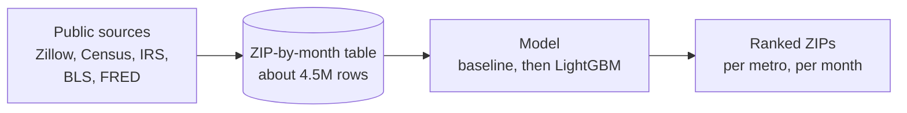

# housing-model

Rank US ZIP codes by how much faster their home prices will grow than their metro
in the next 12 months. Use only free public data.



- **One row:** one ZIP in one month, from 2012 to now.
- **Target:** 12-month forward ZHVI growth, minus the metro mean for that month.
- **Main rule:** a feature joins only after its public release date. This stops leakage.

## Status

| Part | Status |
|---|---|
| Table build (fetch, normalize, build, check) | Written. Tested on synthetic files only. |
| Baselines (momentum, random) | Written. |
| LightGBM model | Not started. See [docs/plan.md](docs/plan.md). |

## Quick start (Mac)

```bash
git clone https://github.com/jmayank23/scratch.git
cd scratch && git checkout housing-model && cd housing-model
python3 -m venv .venv && source .venv/bin/activate
pip install -r requirements.txt
python -m pytest -q          # no network, about 5 seconds
python -m housing all        # download, build, check, baseline
```

Results go to `data/out/`:

- `panel.parquet`: the table.
- `data_card.md`: rows, ZIPs, nulls, check results.
- `baseline_report.md`: the scores a model must beat.

## Documentation

Each link goes one level deeper.

| Read this | For |
|---|---|
| [docs/README.md](docs/README.md) | Plan, data sources, backtest rules |
| [housing/README.md](housing/README.md) | The code: modules, data flow, how to add a source |
| [tests/README.md](tests/README.md) | What the tests check and how the synthetic data works |
| [CLAUDE.md](CLAUDE.md) | Rules for Claude Code sessions in this folder |
