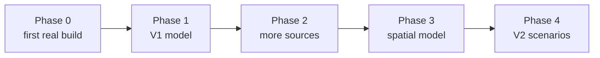

# Plan

[← docs index](README.md)

## Two versions

| | V1: ZIP screener | V2: scenario model |
|---|---|---|
| Question | Which ZIPs will grow faster than their metro next year? | What happens to a ZIP if rates, supply or policy change? |
| Input | The ZIP-by-month table, as of now | The table, plus a scenario (for example rates +1 point, permits ×2) |
| Output | A ranked list per metro, with an interval per ZIP | A price path per ZIP under each scenario |
| Model | LightGBM on the demeaned target | A simulator (world model) where scenario variables are actions |
| How you use it | Read the top of the list | Compare scenarios side by side |

V2 is not only a new engine. It changes how you use the system: from "rank now" to
"compare what-ifs". V1 and its data stay as the base for V2.

## Phases

### Phase 0: first real build (now)

1. Run `python -m housing all` on real downloads.
2. Fix each parser that fails on a real file (`housing/normalize.py`). Do not change
   a test to make it pass: change the synthetic file in `tests/synth.py` to match the
   real format, then fix the parser.
3. Confirm the assumptions in [data-sources.md](data-sources.md) (BPS layout, IRS lag,
   BPS and QCEW release months). Change `housing/config.py` where they are wrong.
4. Set up a monthly refresh that keeps each Zillow snapshot.

**Exit:** `python -m housing check` passes on real data. `data_card.md` shows
about 26,000 ZIPs, and no source group has a null share that you cannot explain.

### Phase 1: V1 model

1. Add `housing/model.py`: LightGBM on `label_g12_dm`, with the folds in
   `housing/splits.py`. Use only the columns in `columns.json` → `features`.
2. Add quantile models (for example 10% and 90%) for an interval per ZIP.
3. Add the model to the backtest report next to `mom12`, `mom3` and `random`.
4. Show feature importance per test year.

**Exit:** the model beats `mom12` on Spearman in most test years, and interval
coverage is near the target in each year.

### Phase 2: more sources

Add one source at a time. Each one gets a parser, an `available_month`, a test and a
row in [data-sources.md](data-sources.md). Keep a source only if the backtest improves.
Candidates are in [data-sources.md](data-sources.md#sources-to-add).

**Exit:** each new source has a measured effect in the backtest.

### Phase 3: spatial model

1. Build a ZCTA adjacency graph (Census ZCTA shapes).
2. Add neighbor features (neighbor mean growth, excluding self).
3. Try a spatio-temporal graph network. Keep LightGBM if the network does not win.

**Exit:** a measured result for neighbor features and for the graph model.

### Phase 4: V2 scenarios

1. Pick the scenario variables (mortgage rate, permits, jobs, a policy event).
2. Train a model that takes those variables as inputs over a path of months.
3. Check it on past shocks (for example the 2022 rate rise) before you trust it.

**Exit:** on past shocks, the scenario model's direction and size are close to what
happened.
