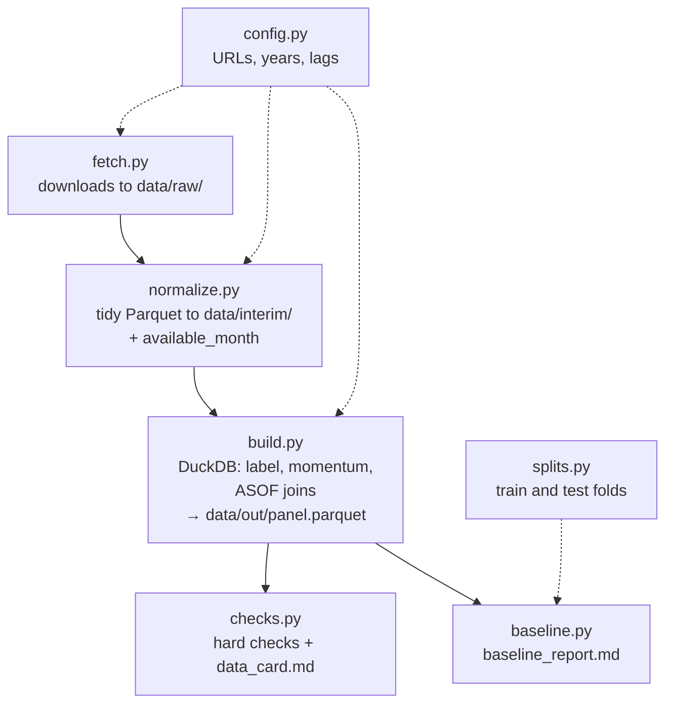

# The `housing` package

[← back to the top README](../README.md)

## Data flow



## Modules

| Module | Does | Writes |
|---|---|---|
| `config.py` | Holds every URL, year range and release lag | |
| `fetch.py` | Downloads each source. Skips files on disk. Skips 400 and 404. Retries other errors 3 times. Logs each file to `manifest.jsonl` | `data/raw/` |
| `normalize.py` | Parses each raw format into a tidy table with `available_month` | `data/interim/*.parquet` |
| `build.py` | Builds the price panel and label, then ASOF-joins each source | `data/out/panel.parquet`, `columns.json` |
| `checks.py` | Runs the hard checks and writes the data card | `data/out/data_card.md` |
| `baseline.py` | Scores the baselines per test year | `data/out/baseline_report.md` |
| `splits.py` | Makes rolling-origin folds with the 13-month purge | |
| `__main__.py` | The command line: `fetch`, `normalize`, `build`, `check`, `baseline`, `all` | |

## Data folders

```
data/
├── raw/            downloads, as published
│   ├── manifest.jsonl
│   ├── zillow/YYYY-MM-DD/   one folder per download date (keep them all)
│   └── acs/ irs/ bps/ qcew/ fred/ crosswalk/
├── interim/        one tidy Parquet per source
└── out/            panel.parquet, columns.json, data_card.md, baseline_report.md
```

`data/` is in `.gitignore`. Do not commit it.

## Column groups (`columns.json`)

- `ids`: zip, month, decision_month, state, metro, county_fips, grp, and others.
- `labels`: every column that starts with `label_`. Never use these as features.
- `meta`: `*_available_month`, `acs_vintage`, `irs_tax_year`, `bps_year`, `qcew_year`,
  `zhvi`. Not features.
- `features`: everything else. A model must use only this list.

## How to add a source

1. Add the URL, years and release lag to `config.py`.
2. Add a `fetch_<name>` function in `fetch.py` and put it in `SOURCES`.
3. Add a `norm_<name>` function in `normalize.py`. It must write a table with a key
   (`zip` or `county_fips`) and an `available_month` column. Put it in `STEPS`.
4. In `build.py`, make a view with `_view(...)` and call `asof(...)`. The checks find
   the new `<name>_available_month` column by its suffix.
5. In `tests/synth.py`, add a writer that copies the real file format. Add a test.
6. Add a row to [docs/data-sources.md](../docs/data-sources.md).

## Command options

- Fetch only some sources: `python -m housing fetch --only zillow fred`
- Download again: `python -m housing fetch --force`
- Use another data folder: `python -m housing --data-dir /Volumes/ext/housing all`
  (or set `HOUSING_DATA_DIR`).
- Census API key (optional, free): `export CENSUS_API_KEY=...` before `fetch`.
  Without a key, the Census API allows about 500 calls per day. ACS needs about
  13 calls if the national ZCTA query works, and up to about 700 if it must query each
  state. If many ACS calls fail, get a key and run `fetch --only acs` again.
- Refresh each month: run `fetch --only zillow` again. Each run saves a new dated
  Zillow folder. Keep the old folders: they are the only record of Zillow's revisions.
