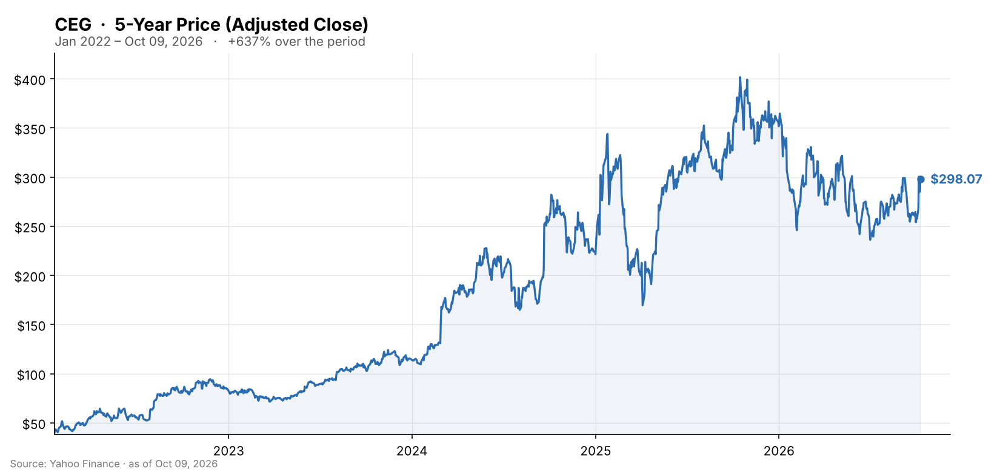

🌐 last30days v3.27.3 · synced 2026-10-11

What I learned:

**Two hyperscaler deals in one week turned Constellation's worst stretch of the year into its best** - On September 30 Constellation and Amazon announced a **20-year power purchase agreement for 690 MW** at Calvert Cliffs in Maryland, including a **190 MW uprate** backed by more than $3 billion of plant investment, with the new capacity arriving in 2030-2032 and the revenue certainty supporting relicensing beyond the current 2034/2036 expirations, per [Constellation](https://www.constellationenergy.com/news/2026/09/constellation-and-amazon-announce-20-year-power-purchase-agreement-at-calvert-cliffs.html) and [ENR](https://www.enr.com/articles/63745-amazon-deal-backs-3b-plus-calvert-cliffs-nuclear-upgrade). Six days later came the bigger one: a **20-year deal with Google for 890 MW of uprates across 11 reactors** in Illinois, Pennsylvania and New Jersey, funded by more than **$4.3 billion** of Constellation capex with first deliveries in 2028, plus a 15-year companion supply agreement for roughly 2,700 MW from the existing fleet - about 3.6 GW in total, per [CNBC](https://www.cnbc.com/2026/10/06/google-enters-massive-3point6-gw-power-deal-with-constellation-energy-.html) and [ANS Nuclear Newswire](https://www.ans.org/news/article-8467/google-constellation-reach-11unit-uprate-plan-constellation-to-invest-43-billion/). CEG rose **12.2% on October 6** to $300.40, one of the two biggest gainers in the S&P 500 that day, and closed the week at **$298.07**, per [GuruFocus](https://www.gurufocus.com/news/9112021/constellation-energy-ceg-surges-121-amid-market-rally-on-october-6-2026). The uprate model is the point: Google and Amazon are paying to squeeze more megawatts out of reactors that already exist, which sidesteps the interconnection queue entirely, per [TheStreet](https://www.thestreet.com/technology/google-constellation-890-megawatts-nuclear-uprate-bypass-power-grid-delay).

**Before that week, 2026 had been a 40% round trip** - CEG peaked at $403.95 in October 2025, opened 2026 at $366, and slid to a **low of $236.50 on July 1** as ERCOT power prices softened and the whole independent-power group de-rated; even after the October surge it is still down ~16% year to date and ~26% below the high. The most recent leg down was regulatory: on September 30 **FERC put PJM's Reliability Backstop Procurement on a five-month paper hearing** over cost allocation, pushing implementation toward February 2027 and delaying the capacity-market upside that had been part of the bull case; CEG fell 4% that day to $254, per [GuruFocus](https://www.gurufocus.com/news/9103782/ferc-delays-pjm-reliability-backstop-filing-weighing-on-constellation-energy-ceg-shares). Analysts have been trimming targets into the rally rather than chasing it: BMO to **$350** from $379 and Scotiabank to **$355** from $441, both still rated Buy/Outperform, while Goldman (Neutral, $305) and Citi (Neutral, $297) sit near the current price, per [CNN Markets](https://www.cnn.com/markets/stocks/CEG) and [Benzinga](https://kr.benzinga.com/quote/CEG/price-targets). Consensus is still roughly $350-355 across 19 analysts (14 Buy, 5 Hold), implying high-teens upside from here.

**The operating story is Calpine, and it is delivering** - Q2 2026 (reported August 6) produced **adjusted operating EPS of $2.55 versus $1.91** a year earlier, driven by higher PJM capacity prices and a first full quarter of Calpine, and management **raised 2026 guidance to $11.50-12.50** from $11.00-12.00, per the [8-K](https://www.sec.gov/Archives/edgar/data/0001868275/000186827526000097/ceg-20260806992.htm) and [TIKR](https://www.tikr.com/blog/constellation-energys-q2-earnings-absorbed-a-weaker-ercot-market-heres-what-happened-to-the-stock). The agreed sale of Brazos Valley to LS Power for $860 million satisfies the last DOJ divestiture condition from the Calpine deal (total required divestitures ~$5.9 billion of proceeds); buybacks are running at $2.2 billion year to date with $2.8 billion of authorization left; and the Crane Clean Energy Center (the former Three Mile Island Unit 1, contracted to Microsoft) is on track for a 2027 restart after the NRC approved its fuel license amendment, per the [Q2 call transcript](https://www.fool.com/earnings/call-transcripts/2026/08/13/constellation-energy-ceg-q2-2026-earnings-call-transcript/). Including the earlier Meta deal for Clinton and roughly 920 MW of 15-to-20-year contracts starting 2029-2032, Constellation now has the deepest contracted nuclear book of any US operator.

**The community debate is about cost per watt and whether the AI buyer shows up** - Reddit engagement was heavy but mostly adjacent: the 15 threads the engine pulled include large r/energy policy threads that mention Constellation only in passing, so the 3,757-upvote total overstates stock-specific discussion. The on-topic threads were the Google deal in r/technology (52 points, 28 comments) and r/nuclear (54 and 50 points). The tone was approving but wary. u/ericl666 (16 upvotes) wrote: "It's better than natural gas or coal powering those things for sure. And if Google is paying for it, then that is better than most deals. I was afraid of them pulling from existing residential capacity." u/eras (17 upvotes) joked: "Next thing we'll know all OpenAI is buying all the uranium for the next decade!" The skeptic's case came from u/hasslehawk in r/nuclear: "Zero percent. The bubble will burst long before the first new reactor comes online to support it." The sharpest analytical comment compared the two uprate programs now in this directory - u/Specific_Advisor4686 noted Constellation's deal works out to about "$5/W" while the DOE loan to Vistra for its uprates "is at $10/W", a useful reminder that Constellation is adding capacity at roughly half the capital cost per watt of the [Vistra](VST-vistra-analysis.md) program. Locally, r/rockford (near the Byron plant) greeted it with "As much as I dislike data centers, improving existing and adding new nuclear capacity is a good thing," per u/TacodWheel (13 upvotes).

**YouTube is where the valuation argument lives, and it is split** - Nathan Robert's "I'd Go All in Constellation Energy" (923 views) leans on scale - "They own over 30% of all operating nuclear reactors in the US" - while Before You Buy's two explainers argue the opposite from a discounted-cash-flow angle, putting fair value near **$302** and calling the stock roughly fairly priced after the jump; a commenter on Parkev Tatevosian's video (5,698 views) put the bear case in one line: "Their ROIC is close to WACC, that itself means that they should be traded closer to book value." GuruFocus has the stock at a trailing P/E near 29x against a five-year median of 28x, per [GuruFocus](https://www.gurufocus.com/news/9112021/constellation-energy-ceg-surges-121-amid-market-rally-on-october-6-2026). No Polymarket market exists on Constellation, and Hacker News carried only the Reuters headline. The next hard catalyst is Q3 results, which Constellation has not yet dated; its usual cadence puts them in early November.

KEY PATTERNS from the research:
1. Google (890 MW of uprates, >$4.3B capex, 20 years, plus ~2.7 GW of fleet supply) and Amazon (690 MW incl. a 190 MW Calvert Cliffs uprate, >$3B) signed within six days; CEG +12% on October 6, per [CNBC](https://www.cnbc.com/2026/10/06/google-enters-massive-3point6-gw-power-deal-with-constellation-energy-.html) and [Constellation](https://www.constellationenergy.com/news/2026/09/constellation-and-amazon-announce-20-year-power-purchase-agreement-at-calvert-cliffs.html).
2. Uprates bypass the interconnection queue - the same logic as Vistra's DOE-backed program, at roughly half the cost per watt, per [TheStreet](https://www.thestreet.com/technology/google-constellation-890-megawatts-nuclear-uprate-bypass-power-grid-delay) and community analysis.
3. Q2 EPS $2.55 vs $1.91 and 2026 guidance raised to $11.50-12.50 on Calpine; Brazos Valley sale clears the last DOJ condition; Crane restart targeted for 2027, per the [8-K](https://www.sec.gov/Archives/edgar/data/0001868275/000186827526000097/ceg-20260806992.htm).
4. FERC's five-month pause of PJM's reliability backstop (to ~Feb 2027) is the live regulatory overhang and knocked 4% off the stock on September 30, per [GuruFocus](https://www.gurufocus.com/news/9103782/ferc-delays-pjm-reliability-backstop-filing-weighing-on-constellation-energy-ceg-shares).
5. Consensus ~$350-355 but targets are being cut (BMO $350, Scotiabank $355) and the Neutral camp (Goldman $305, Citi $297) sits at today's price; valuation, not demand, is the debate, per [CNN Markets](https://www.cnn.com/markets/stocks/CEG).

---
✅ All agents reported back!
├─ 🟠 Reddit: 15 threads │ 3,757 upvotes │ 441 comments
├─ 🔴 YouTube: 6 videos │ 6,845 views │ 4/6 with transcripts
├─ 🟡 HN: 1 story │ 4 points
├─ 🗣️ Top voices: r/energy, r/nuclear, r/rockford
└─ 📎 Raw results saved to /home/user/scratch/reports/raw/constellation-energy-ceg-stock-raw-v3.md
---

---
I'm now an expert on Constellation Energy (CEG) for the last 30 days. Some things you could ask:
- How much of the $4.3B Google uprate program is funded from cash flow versus new debt, and what does it do to buybacks?
- What exactly did FERC pause in PJM, and which part of the bull case depends on it resuming in 2027?
- How do the Calvert Cliffs and 11-reactor uprates compare in cost per watt with Vistra's DOE-backed program?

I have all the links to the 15 Reddit threads, 6 YouTube videos and 1 HN story I pulled from, plus the 14 web pages cited above. Note that most Reddit volume was adjacent policy discussion rather than stock talk, and no Polymarket market exists for this name.

---

### 5-Year Price

▲ **+637% since the February-2022 spin-off from Exelon** - adjusted close rose from $40.43 (first full month of trading, January 2022) to $298.07. CEG has less than five years of history, so the chart covers the full listing. Source: Yahoo Finance (daily adjusted close through Oct 2026).

