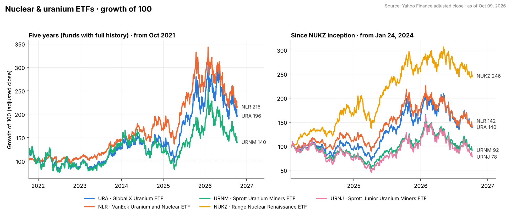

# Nuclear Energy ETFs - A Comparison

A screen of the six US-listed nuclear and uranium ETFs, assembled on **2026-10-11** from issuer and fund-data pages (holdings, fees, assets as of the Oct 9, 2026 close) and Yahoo Finance adjusted-close prices. This is a fund comparison, not a `/last30days` sentiment run - there is little community discussion of the funds themselves; the discussion lives in the single names ([CEG](CEG-constellation-analysis.md), [VST](VST-vistra-analysis.md)) that several of these funds hold.

## The short version

- **For "nuclear energy" as this directory has been looking at it - reactor operators plus their supply chain - the closest fit is `NLR` (VanEck Uranium and Nuclear ETF).** It is the cheapest of the group (0.52%), the oldest (2007), pays a ~3% yield, and mixes operators (Constellation 9%, PSEG 8%, Fortum 7%) with fuel (Cameco, Kazatomprom) and next-generation developers (Oklo, X-Energy, BWX Technologies). The trade-off is concentration: 28 holdings, and it is 37% below its 52-week high after a -27% year.
- **For the broadest "nuclear renaissance" basket, `NUKZ` (Range Nuclear Renaissance Index ETF).** 59 holdings spanning utilities (Duke, Dominion, PG&E, KEPCO, Endesa), equipment (GE Vernova, Rolls-Royce, Emerson), the independent power producers in this directory (Vistra 3.2%, Constellation 3.0%, Talen 3.5%) and SMR developers (Oklo). It has held up best over the past year (-10%) but costs the most (0.85%) and is the second-smallest fund here ($676M).
- **For a bet on the uranium price rather than on nuclear operators, `URA` or `URNM`.** Both are dominated by Cameco (21-23%) plus physical uranium trusts, so they move with the spot/term uranium market and are the most volatile of the group. `URNJ` is the high-beta junior-miners version (-32% over the past year).
- **`URAN` has the lowest fee (0.35%) but only $24M in assets** - thin liquidity is a real cost that the expense ratio does not show.

None of this is a recommendation to buy any fund; it is a map of what each one actually owns. Every fund in the group is down over the past year because the whole sector de-rated in 2026 - see the price panel below and the discussion of the 2026 selloff in the [Vistra](VST-vistra-analysis.md) and [Constellation](CEG-constellation-analysis.md) reports.

## Side by side

| | **URA** | **NLR** | **NUKZ** | **URNM** | **URNJ** | **URAN** |
|---|---|---|---|---|---|---|
| Fund | Global X Uranium ETF | VanEck Uranium and Nuclear ETF | Range Nuclear Renaissance Index ETF | Sprott Uranium Miners ETF | Sprott Junior Uranium Miners ETF | Themes Uranium & Nuclear ETF |
| What it is | Uranium miners + physical uranium + some SMR | Operators, fuel, equipment, SMR developers | Broad "renaissance" basket: utilities, equipment, IPPs, SMR | Pure uranium miners + physical uranium | Small-cap uranium miners | Operators + fuel, utility-heavy |
| Expense ratio | 0.69% | **0.52%** | 0.85% | 0.75% | 0.80% | 0.35% |
| Net assets | **$5.50B** | $3.50B | $676M | $1.82B | $308M | $24M |
| Holdings | 60 | 28 | 59 | 30 | 48 | 56 |
| Inception | Nov 2010 | Aug 2007 | Jan 2024 | Dec 2019 | Feb 2023 | Sep 2024 |
| Largest holding | Cameco 22.9% | Constellation 9.2% | Cameco 9.1% | Cameco 21.1% | NexGen 13.5% | Constellation 8.9% |
| Holds CEG / VST? | no / no | **CEG 9.2%** | **CEG 3.0% / VST 3.2%** | no | no | CEG 8.9% |
| Trailing yield | ~0% | 3.1% | 0.9% | 3.8% | 8.7%* | n/a |
| 1-year total return | -21% | -27% | **-10%** | -22% | -32% | -27% |
| YTD (price) | -9% | -17% | **-4%** | -15% | -24% | -16% |
| 5 years (adj.) | +96% | **+116%** | n/a (+146% since Jan 2024) | +40% | n/a | n/a |
| Off 52-week high | -37% | -37% | n/a | -45% | n/a | n/a |

\* URNJ's trailing yield reflects a large capital-gains distribution, not income.

Sources: [Global X URA](https://www.globalxetfs.com/funds/ura/), [StockAnalysis NLR](https://stockanalysis.com/etf/nlr/) and [holdings](https://stockanalysis.com/etf/nlr/holdings/), [StockAnalysis NUKZ](https://stockanalysis.com/etf/nukz/) and [holdings](https://stockanalysis.com/etf/nukz/holdings/), [StockAnalysis URNM](https://stockanalysis.com/etf/urnm/), [StockAnalysis URNJ](https://stockanalysis.com/etf/urnj/), [StockAnalysis URAN](https://stockanalysis.com/etf/uran/), [Range NUKZ](https://rangeetfs.com/nukz/); returns computed from Yahoo Finance adjusted close through Oct 9, 2026. Fee and holdings comparisons cross-checked against [The Motley Fool](https://www.fool.com/investing/stock-market/market-sectors/energy/nuclear/nuclear-etfs/), [24/7 Wall St.](https://247wallst.com/investing/2026/07/19/5-uranium-etfs-to-buy-before-nuclear-demand-triples-by-2050/) and [US News](https://money.usnews.com/investing/articles/best-nuclear-energy-stocks-and-etfs-to-buy-now).

## What each one actually owns

**URA (Global X Uranium).** Cameco 22.9%, Sprott Physical Uranium Trust 7.2%, NexGen 5.9%, Oklo 5.5%, Uranium Energy 4.7%, Kazatomprom 4.5%, Centrus 2.8%, Paladin 2.8%, Energy Fuels 2.7%, NuScale 2.6%. Despite the name it has drifted toward "nuclear components" and now carries ~8% in SMR developers, but it is still, first, a uranium-price fund.

**NLR (VanEck Uranium and Nuclear).** Constellation 9.2%, Cameco 8.2%, PSEG 8.2%, Fortum 7.1%, BWX Technologies 6.5%, CGN Power 5.5%, NexGen 5.3%, Oklo 4.8%, Kazatomprom 4.5%, X-Energy 4.3%, Uranium Energy 4.2%, Centrus 3.9%, Paladin 3.8%, Denison 3.8%, Energy Fuels 3.6%. Roughly a third operators, a third fuel, a third equipment/developers - the most balanced nuclear-energy exposure of the six.

**NUKZ (Range Nuclear Renaissance).** Cameco 9.1%, Talen 3.5%, GE Vernova 3.4%, Vistra 3.2%, Oklo 3.2%, Constellation 3.0%, Solstice Advanced Materials 3.0%, Duke 3.0%, Endesa 3.0%, Rolls-Royce 2.9%, Dominion 2.9%, Fortum 2.9%, PG&E 2.8%, KEPCO 2.7%, Emerson 2.7%. Nearly equal-weighted across 59 names, so no single holding dominates; it is the only fund here that owns both Vistra and Constellation in size and the only one with meaningful equipment-maker exposure.

**URNM (Sprott Uranium Miners).** Cameco 21.1%, Sprott Physical Uranium Trust 15.7%, NexGen 12.6%, CGN Mining 4.8%, Kazatomprom 4.7%, Uranium Energy 4.5%, Yellow Cake 4.3%, Paladin 4.1%, Denison 4.0%, Energy Fuels 3.9%. The top three are half the fund and ~16% is physical uranium - the purest uranium-price proxy of the group.

**URNJ (Sprott Junior Uranium Miners).** NexGen 13.5%, Paladin 11.5%, Denison 11.0%, Energy Fuels 10.6%, IsoEnergy 5.2%. Small-cap developers and explorers; the most volatile fund here in both directions.

**URAN (Themes Uranium & Nuclear).** Constellation 8.9%, Cameco 8.5%, Kazatomprom 4.2%, AEP 3.6%, Duke 3.6%. A sensible utility-heavy basket at the lowest fee, but at $24M of assets it is too small for most investors to trade without paying a wide spread.

## Price history

Left: the three funds with a full five-year record, indexed to 100 in October 2021. Right: all five liquid funds indexed to 100 at NUKZ's January-2024 launch. Two things stand out. Over five years the operator-heavy NLR (+116%) beat the miner-heavy URA (+96%) and URNM (+40%) - owning the reactors paid better than owning the fuel. Since 2024 the broadest basket, NUKZ (+146%), has led, and it has also fallen least in the 2026 de-rating (-10% over the past year versus -21% to -32% for the uranium funds). The 2026 drawdown is sector-wide: every fund on the chart is 25-45% below its 2025 high.

## How to think about the choice

1. **Decide what you want exposure to.** Reactor economics (operators like CEG, VST, PSEG) and uranium economics (Cameco, Kazatomprom, physical uranium) are different trades that happened to rally together in 2024-25. NLR and URAN are operator-tilted; URA, URNM and URNJ are uranium-tilted; NUKZ spans both plus equipment.
2. **Overlap with single names.** If you already hold CEG or VST, NLR and URAN add more CEG; NUKZ adds a little of both; the uranium funds add none.
3. **Concentration.** URA and URNM are each >20% Cameco. NUKZ is the most diversified; NLR has the fewest holdings (28).
4. **Cost and size.** Fees range 0.35-0.85% but the real outlier is URAN's $24M of assets. The three funds with real liquidity are URA, NLR and URNM; NUKZ is adequate at $676M.
5. **Yield.** NLR and URNM pay 3-4% trailing; URA and NUKZ pay little; URNJ's headline yield is a one-off distribution.

## Caveats

Fund data are a single-day snapshot (Oct 8-9, 2026) and holdings rebalance regularly; returns are price/adjusted-close based and exclude the funds' tracking costs beyond the stated expense ratios; "1-year total return" figures come from StockAnalysis and include distributions, while the 5-year and YTD figures were computed from Yahoo Finance adjusted/raw close. This is informational and **not investment advice**.
