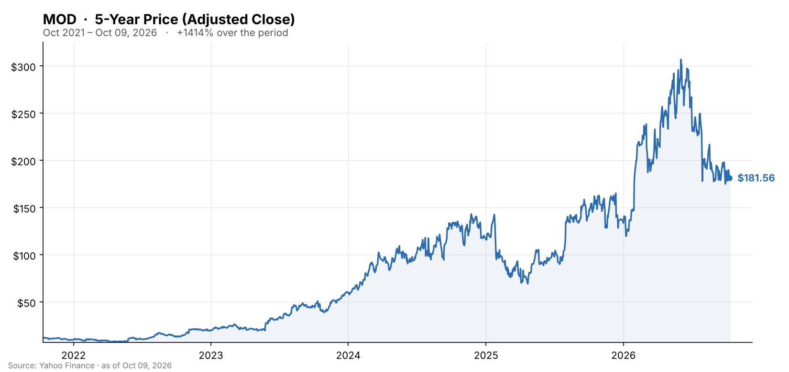

🌐 last30days v3.27.3 · synced 2026-10-11

What I learned:

**Modine just became a pure play on data-center cooling, and the market has not paid it for that yet** - On October 1 Modine completed the spin-off of its Performance Technologies business (vehicle and off-highway thermal) and its combination with Gentherm in a Reverse Morris Trust. Modine shareholders received **0.44619 Gentherm shares per MOD share**, roughly 40% of the combined company, and Modine collected **$156 million** of cash - less than the $210 million projected when the deal was announced in January, per [Morningstar/PR Newswire](https://www.morningstar.com/news/pr-newswire/20261001ny61860/modine-completes-spin-off-and-combination-of-its-performance-technologies-business-with-gentherm) and the [Gentherm 8-K/A](https://www.sec.gov/Archives/edgar/data/0000903129/000119312526419232/d186467dex994.htm). What remains is Climate Solutions: the Airedale data-center cooling franchise plus commercial HVAC. The stock is **$181.56**, still up 36% for the year but **41% below its June 2 high of $306.89**, and it sits below its 200-day average (~$231). The separation itself was messy for the tape: on the September 28 record date MOD fell 11.6% to $175 as shares traded with due bills attached, which analysts attributed to spin-off mechanics rather than any operating news, per [GuruFocus](https://www.gurufocus.com/news/9100617/modine-manufacturing-co-mod-shares-fall-116-gf-value-says-still-overvalued) and [Quiver Quant](https://www.quiverquant.com/news/Modine+Manufacturing+Company+Slides+as+Investors+Weigh+Spin-Off+Trading+Mechanics).

**The growth is real; the margins are the problem** - Fiscal Q1 2027 (reported July 29) showed net sales of **$874.1 million, up 28%**, with **Data Centers revenue up 90%** to $348.6 million on North American hyperscale demand. But data-center gross margin fell **960 basis points to 20.2%** and the segment's adjusted EBITDA margin dropped to 14.8% from 22.1%, which management blamed on component shortages that left excess labor and under-absorbed overhead (450-550 bp of the hit), per [Investing.com](https://www.investing.com/news/company-news/modine-q1-fy27-slides-data-center-sales-surge-90-amid-margin-pressure-93CH-4825716) and [Zacks via Yahoo Finance](https://finance.yahoo.com/markets/stocks/articles/mod-q1-earnings-top-estimates-121100545.html). Adjusted EPS of $1.53 beat; sales came in slightly short. Full-year guidance was reaffirmed - **sales +20-35%, adjusted EBITDA $650-680 million, Data Centers +60-80%** - with companywide margins expected to improve 200-250 bp sequentially in Q2 and the segment margin to recover to 19-20%, per the [results release](https://www.prnewswire.com/news-releases/modine-reports-first-quarter-fiscal-2027-results-302838002.html). The stock had already fallen **29% in the five sessions into the print** ($249.64 on July 22 to $178.04 on July 29) and bounced 9% the day after, so the market was pricing a margin problem before management confirmed one.

**The bull case is a $4 billion backlog with one customer's name on it** - In May Modine signed a long-term capacity agreement guaranteeing supply for **more than $4 billion of Airedale cooling products to a single unnamed strategic data-center customer across calendar 2027-2029**, backed by a **$165 million upfront payment** to fund the capacity build, per [DCD](https://www.datacenterdynamics.com/en/product-news/modine-announces-landmark-4-billion-long-term-capacity-agreement-through-2029-with-strategic-data-center-customer-for-airedale-by-modine-cooling-solutions/) and [Barchart](https://www.barchart.com/story/news/2125847/modine-announces-landmark-4-billion-long-term-capacity-agreement-through-2029-with-strategic-data-center-customer-for-airedale-by-modine-cooling-solutions). That agreement is the thesis and the risk in one document: visibility through 2029, and concentration in one hyperscaler whose own capex plans the stock now tracks. Management has also expanded manufacturing in Grand Prairie, Texas, and promised an updated outlook for the continuing business after the spin, with a full strategy and multi-year targets at an **investor day on November 18**, per [MarketBeat](https://www.marketbeat.com/instant-alerts/analyst-modine-manufacturing-nyse-mod-stock-bumped-up-to-strong-buy-by-robert-w-baird-2026-10-07/).

**Vertiv is the yardstick, and right now Modine is losing the margin comparison** - Vertiv posted a 22.6% adjusted operating margin in its latest quarter (up 410 bp) against Modine's 14.8% data-center segment margin, and Vertiv's incumbency inside Microsoft and Meta facilities is the recurring objection to Modine's "pure play" pitch, per [Zacks via TradingView](https://www.tradingview.com/news/zacks:6b329607f094b:0-ai-data-center-cooling-mod-s-pivot-vs-vrt-s-moat-the-better-bet/). Earlier in 2026 Modine was the better stock (+113% year to date versus Vertiv's +85% at the spring peak, per [Yahoo Finance](https://finance.yahoo.com/markets/stocks/articles/mod-vs-vrt-stock-better-151500152.html)); over the last six months it is down 14% while Vertiv gained 8%, per [The Globe and Mail](https://www.theglobeandmail.com/investing/markets/stocks/VRT/pressreleases/3974464/why-modine-stock-could-be-one-of-ais-overlooked-winners/). The chiller-and-CDU demand both companies are chasing is not in doubt; who earns the margin on it is.

**Analysts kept their ratings and cut their numbers, so the stock trades ~40% below consensus** - Robert W. Baird **upgraded MOD to Outperform on October 7**; Oppenheimer cut its target to **$260 from $300** while staying at Outperform; the consensus is "Moderate Buy" with a target near **$309.50**, per [MarketBeat](https://www.marketbeat.com/instant-alerts/analyst-modine-manufacturing-nyse-mod-stock-bumped-up-to-strong-buy-by-robert-w-baird-2026-10-07/). [StockAnalysis](https://stockanalysis.com/stocks/mod/) shows an average target of about $330 from eight analysts rating it Strong Buy, with UBS at $355 the high. A target gap that wide usually means the Street has not yet re-based numbers for the smaller post-spin company, which is exactly what November 18 is for. Fiscal Q2 results have not been dated; last year's came on October 29.

**Community coverage was effectively nil, and that is itself the finding** - The engine found three Reddit threads with five upvotes between them, no Hacker News discussion and no Polymarket market, and it flagged the window as "limited recent data." The only on-topic thread was in the tiny dedicated sub r/MOD_Stock, "Modine / Gentherm Spin-Off Update - What It Means for $MOD Holders" (4 points), where u/Ty-Nitty (1 upvote) described holding the Gentherm shares received in the spin: "I am holding my THRM shares watching them tank daily because they might be getting washed out, so were I to sell them, there might be an immediate spike upward. Wish I had never bought them though." A second thread in r/investing, "$MOD Is Becoming a Pure AI Data Center Cooling Play," drew no visible engagement. The six YouTube results (1.9 million views) were keyword noise - Oppenheimer film breakdowns, an Equinix liquid-cooling explainer and a scooter review - rather than Modine coverage, and the YouTube search was partially blocked by a bot check. For a stock that was up 113% at one point this year, the absence of any retail narrative after a 41% drawdown is notable: nobody is defending it, and nobody is piling on either.

KEY PATTERNS from the research:
1. Spin-off closed October 1: Modine holders got 0.44619 Gentherm shares per share and Modine received $156M (vs $210M projected); the remaining company is data-center cooling plus commercial HVAC, per [Morningstar/PR Newswire](https://www.morningstar.com/news/pr-newswire/20261001ny61860/modine-completes-spin-off-and-combination-of-its-performance-technologies-business-with-gentherm).
2. Data Centers revenue +90% but segment margin 14.8% vs 22.1% on component shortages; guidance reaffirmed with a 200-250 bp sequential margin recovery promised, per [Investing.com](https://www.investing.com/news/company-news/modine-q1-fy27-slides-data-center-sales-surge-90-amid-margin-pressure-93CH-4825716).
3. A >$4B, 2027-2029 capacity agreement with one unnamed hyperscaler ($165M upfront) anchors the backlog and the concentration risk, per [DCD](https://www.datacenterdynamics.com/en/product-news/modine-announces-landmark-4-billion-long-term-capacity-agreement-through-2029-with-strategic-data-center-customer-for-airedale-by-modine-cooling-solutions/).
4. Vertiv's 22.6% margin and hyperscaler incumbency are the competitive objection; MOD has lagged VRT by ~22 points over six months, per [Zacks via TradingView](https://www.tradingview.com/news/zacks:6b329607f094b:0-ai-data-center-cooling-mod-s-pivot-vs-vrt-s-moat-the-better-bet/).
5. Baird upgrade (Oct 7) and Oppenheimer cut to $260 leave consensus ~$310-330, roughly 40% above the price, with the November 18 investor day the re-basing event, per [MarketBeat](https://www.marketbeat.com/instant-alerts/analyst-modine-manufacturing-nyse-mod-stock-bumped-up-to-strong-buy-by-robert-w-baird-2026-10-07/).

---
✅ All agents reported back!
├─ 🟠 Reddit: 3 threads │ 5 upvotes │ 5 comments
├─ 🔴 YouTube: 6 videos │ 1,902,661 views │ 5/6 with transcripts
├─ 🗣️ Top voices: r/dividends, r/investing, r/MOD_Stock
├─ 🕒 Limited recent data: only 1 of 9 dated items are from the last 7 days.
└─ 📎 Raw results saved to /home/user/scratch/reports/raw/modine-mod-stock-raw-v3.md
---

---
I'm now an expert on Modine (MOD) for the last 30 days. Some things you could ask:
- What does the continuing company look like after the spin - revenue, margin and leverage without Performance Technologies?
- How much of the $4B Airedale agreement is firm order versus reserved capacity, and what happens if the customer slows?
- Can Modine close the margin gap to Vertiv, or is 15-20% the structural level for a chiller maker?

I have the links to the 3 Reddit threads and 6 YouTube videos the engine pulled (the videos were off-topic), plus the 15 web pages cited above. Community coverage here is genuinely thin - treat the sentiment read as partial.

---

### 5-Year Price

▲ **+1,414% over 5 years** - adjusted close rose from $11.99 to $181.56. Source: Yahoo Finance (daily adjusted close, ~5 years through Oct 2026).

