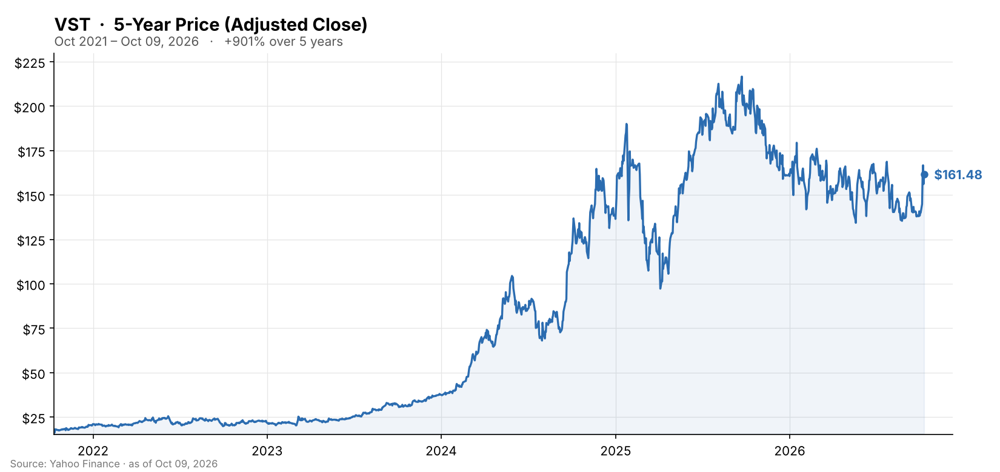

🌐 last30days v3.27.3 · synced 2026-10-11

What I learned:

**Vistra just got a federal lifeline for its nuclear fleet, and the stock reacted like it mattered** - On October 5-6 the Department of Energy's Office of Energy Dominance Financing issued a **conditional loan commitment of up to $4.2 billion** to extend and upgrade three Vistra plants: Beaver Valley in Pennsylvania and Davis-Besse and Perry in Ohio. The work would add **433 MW** of new nuclear capacity, preserve nearly **4 GW** of baseload for an additional 20 years beyond current licenses, and the commitment carries an option to finance future uprates at Comanche Peak in Texas, per [Rigzone](https://www.rigzone.com/news/vistra_gets_conditional_42b_doe_loan_for_pjm_nuclear_fleet-06-oct-2026-184787-article/) and [ANS Nuclear Newswire](https://www.ans.org/news/article-8464/vistra-gets-42b-doe-loan-for-planned-uprates-in-ohio-pennsylvania/). It is conditional - Vistra must clear technical, legal, environmental and financial hurdles before definitive documents are signed, per [The Motley Fool](https://www.fool.com/investing/2026/10/06/department-of-energy-announces-a-new-multi-billion-dollar-nuclear-energy-deal/). The same day, Google signed a 20-year deal with Constellation for ~3,590 MW including 890 MW of uprates across 11 reactors, and the whole nuclear-power complex ripped: Constellation +12%, **Vistra +8-11%**, Talen +7-13%, per [CNBC](https://www.cnbc.com/2026/10/06/google-constellation-energy-ceg-nuclear-power-data-center.html) and [24/7 Wall St.](https://247wallst.com/investing/2026/10/06/constellation-energy-soars-12-on-google-nuclear-deal-for-890-mw-vistra-jumps-8-talen-energy-climbs-7/). VST went from $138 at the end of September to $167 on October 7, gave back 6% on October 8, and closed the week at **$161.48** - up ~17% in seven sessions and, remarkably, almost exactly where it ended 2025 ($161.33).

**The 2026 story before October was a slow bleed on Texas power prices, not a broken business** - VST peaked at $217.92 in September 2025, made a 2026 high of $180 in mid-January, bottomed at **$134.71 on May 19**, and then chopped between $135 and $158 all summer. The cause was ERCOT: CEO Jim Burke said wholesale power has averaged about **$30/MWh** year to date, flat on last year, and that "$30 is not going to get new stuff built," per the [Q2 call transcript](https://equibles.com/stocks/vst/calls/2026-q2). Softer 2027 ERCOT forward curves pushed third-party summaries to say the **2027 EBITDA opportunity ($7.4-7.8B) is tracking toward the low end**, per [Yahoo Finance](https://finance.yahoo.com/markets/stocks/articles/vistra-q2-earnings-call-highlights-150418961.html), and Vistra trimmed its ERCOT load-growth view to 4-6% from 5-6%, per [Utility Dive](https://www.utilitydive.com/news/vistra-texas-data-center-pause-comanche-amazon-earnings/827434/). Governor Abbott's audit of every data center in the ERCOT interconnection queue (474 GW of requests) and ERCOT's delay of its "Batch Zero" large-load study added uncertainty about when Texas demand actually shows up, per [Utility Dive](https://www.utilitydive.com/news/texas-hits-pause-data-center-interconnections/827046/). Peers fell with it: Constellation, NRG and Talen were each down more than 20% year to date by September, with one piece calling it a valuation reset rather than an operational break, per [24/7 Wall St.](https://247wallst.com/investing/2026/09/14/vistras-price-has-edged-downward-throught-2026-one-analyst-says-its-due-to-double-soon/).

**The operating numbers are strong, and most of the next two years is already sold forward** - Q2 2026 (reported August 7) delivered Ongoing Operations Adjusted EBITDA of **$1,767M, up 31%** from $1,349M, on higher realized energy and capacity prices and a first full quarter from the Lotus gas plants; GAAP net income was $305M after a $472M unrealized mark-to-market hedge loss, per [Vistra's release](https://investor.vistracorp.com/2026-08-07-Vistra-Reports-Second-Quarter-2026-Results). Revenue missed consensus, per [Investing.com](https://www.investing.com/news/transcripts/earnings-call-transcript-vistra-misses-q2-2026-estimates-as-revenue-falls-short-93CH-4847086). Vistra reaffirmed 2026 guidance of $6.8-7.6B EBITDA and $3.925-4.725B adjusted free cash flow before growth. The reason ERCOT weakness has not hit guidance is hedging: **~100% of 2026, ~94% of 2027 and ~72% of 2028** expected generation is hedged. Capital return continues - $6.5B repurchased since November 2021, share count down ~30% to ~336M, $1.2B of authorization left to be used by end-2027 - and on September 10 Vistra priced **$1.5B of junior subordinated notes due 2057** (7.00% and 7.25%) to refinance its 8% and 7% preferred stock at their October/December reset dates, per [Davis Polk](https://www.davispolk.com/experience/vistra-1-5-billion-junior-subordinated-notes-offering). Q3 results are scheduled for **November 6**, per [Vistra IR](https://investor.vistracorp.com/news).

**The AI-power thesis now rests on ~3.8 GW of contracted nuclear plus two growth vehicles** - Vistra has a 20-year, **1,200 MW** PPA from Comanche Peak with Amazon Web Services (delivery from Q4 2027, full by 2032, 8-10% free-cash-flow accretion if fully used) and January 2026 PPAs with **Meta** covering its Ohio and Pennsylvania nuclear units - the same plants the DOE loan now backs - for roughly 3,800 MW of total nuclear offtake, per [World Nuclear News](https://www.world-nuclear-news.org/articles/ppas-support-extended-operations-at-vistra-plants) and [Power Engineering](https://www.power-eng.com/nuclear/vistra-secures-long-term-nuclear-ppa-from-comanche-peak-nuclear-plant/). Burke said the Texas pause should not touch Comanche Peak: "We don't see [Comanche Peak] being affected at this point," with the Amazon campus still slated to energize in 2027, and added "I'd like to see the queues culled," per [Utility Dive](https://www.utilitydive.com/news/vistra-texas-data-center-pause-comanche-amazon-earnings/827434/). Growth comes from two directions: the **$4.7B Cogentrix acquisition** (10 gas plants, 5.5 GW; FERC-approved in August, expected to close late 2026 and excluded from guidance), per [Utility Dive](https://www.utilitydive.com/news/vistra-cogentrix-natural-gas-energy-deal-data-centers/808854/), and **Helix Digital Infrastructure**, a data-center venture with KKR, NVIDIA and the Kuwait Investment Authority where Vistra commits up to $1.0B (amounts above $500M tied to milestones) and is the preferred power provider, per [GuruFocus](https://www.gurufocus.com/news/9018234/vistra-corp-vst-q2-2026-earnings-call-highlights-record-ebitda-surge-and-strategic-helix-partnership-fuel-growth).

**Wall Street still sees ~30% upside, but the targets are drifting down, not up** - Consensus sits around **$216-225** across 20-24 analysts, per [Chartmill](https://www.chartmill.com/stock/quote/VST/analyst-ratings) and [TIKR](https://www.tikr.com/blog/is-vistra-stock-undervalued-in-2026-the-street-thinks-so-at-225-mean-target), with Guggenheim at $300 the high and Mizuho's $169 initiation the low. This window's moves were cuts: BMO to $210 from $231 (still Outperform) and Scotiabank to $207 from $298, per [CNN Markets](https://www.cnn.com/markets/stocks/VST); the one new bull was Siebert Williams Shank initiating at Buy with a **$202 target** on October 2, citing contracted earnings, the hedge book and the Meta/AWS deals, per [MarketBeat](https://www.marketbeat.com/instant-alerts/analyst-vistra-nyse-vst-coverage-initiated-by-analysts-at-siebert-williams-shank-2026-10-02/). Insiders sold into the spike: CFO Kristopher Moldovan's family trust sold 20,000 shares at $165 on October 7 and EVP Scott Hudson sold 22,222 at ~$160 on October 6, both under pre-set 10b5-1 plans, per [StockTitan](https://www.stocktitan.net/sec-filings/VST/form-4-vistra-corp-insider-trading-activity-dcb40a1b67db.html) and [MarketBeat](https://www.marketbeat.com/instant-alerts/price-vistra-nyse-vst-shares-down-62-following-insider-selling-2026-10-08/). That sits awkwardly next to the most-watched video of the month, The Patient Investor's "Why Insiders Are Loading Up on Vistra Stock" (13,142 views, 329 likes).

**Community coverage was thin and skewed toward the political-ownership angle rather than fundamentals** - The engine found only 5 Reddit threads and 3 YouTube videos, no Hacker News discussion and no Polymarket market on Vistra, and YouTube transcripts could not be fetched (bot-check), so this is a **partial read**, not evidence of silence. The one thread with real traction was in r/TrumpsTrades (333 points, 45 comments), framed as "US government plans $4B loan to Vistra (VST). Trump, Pelosi & Peter Thiel own Vistra stock." - a conflict-of-interest reading of the loan rather than an energy one. The tone there was rueful, not euphoric: u/callesucia (29 upvotes) wrote "Damn, I'm always late to this shit"; u/hakansan (23 upvotes) countered "We haven't seen the price action yet:)" the weekend before the jump; and u/Resident-Banana-7883 (13 upvotes) captured the five-month round trip: "saw this and thought, shoot I shouldn't of sold my vst in may! -checks price- nevermind lol." The broader r/StockMarket thread that around 35% of the President's personal portfolio is in AI-related names (2,714 points, 92 comments) pulled VST in by association. On YouTube, Stock Valley framed the chart question as whether VST "can finally clear the $170 level that sits between its $132 floor and the $200-215 zone" - which is exactly where the October 7 high ($166.72) stalled.

KEY PATTERNS from the research:
1. A conditional DOE loan of up to $4.2B backs life-extension and 433 MW of uprates at Beaver Valley, Davis-Besse and Perry, with an option covering Comanche Peak, per [Rigzone](https://www.rigzone.com/news/vistra_gets_conditional_42b_doe_loan_for_pjm_nuclear_fleet-06-oct-2026-184787-article/).
2. The Google-Constellation 890 MW uprate deal lifted the whole nuclear complex in sympathy; VST rallied ~17% in seven sessions to $161, back to its 2025 close, per [CNBC](https://www.cnbc.com/2026/10/06/google-constellation-energy-ceg-nuclear-power-data-center.html).
3. The 2026 drawdown was about ~$30/MWh ERCOT power and Texas data-center queue uncertainty, cushioned by ~94% hedging for 2027, per [Utility Dive](https://www.utilitydive.com/news/vistra-texas-data-center-pause-comanche-amazon-earnings/827434/) and [Vistra IR](https://investor.vistracorp.com/2026-08-07-Vistra-Reports-Second-Quarter-2026-Results).
4. Growth stack: ~3.8 GW of nuclear PPAs with AWS and Meta, the 5.5 GW Cogentrix gas deal closing late 2026, and the Helix data-center venture with KKR/NVIDIA/KIA, per [World Nuclear News](https://www.world-nuclear-news.org/articles/ppas-support-extended-operations-at-vistra-plants) and [Utility Dive](https://www.utilitydive.com/news/vistra-cogentrix-natural-gas-energy-deal-data-centers/808854/).
5. Analysts' $216-225 consensus implies ~30% upside but recent revisions were cuts (BMO $210, Scotiabank $207), and two executives sold on the spike under 10b5-1 plans, per [CNN Markets](https://www.cnn.com/markets/stocks/VST) and [StockTitan](https://www.stocktitan.net/sec-filings/VST/form-4-vistra-corp-insider-trading-activity-dcb40a1b67db.html).

---
✅ All agents reported back!
├─ 🟠 Reddit: 5 threads │ 3,051 upvotes │ 167 comments
├─ 🔴 YouTube: 3 videos │ 13,674 views │ 0/3 with transcripts
├─ 🗣️ Top voices: r/stockstobuytoday, r/TrumpsTrades, r/wallstreetbetsGER
└─ 📎 Raw results saved to /home/user/scratch/reports/raw/vistra-vst-stock-raw-v3.md
---

---
I'm now an expert on Vistra (VST) for the last 30 days. Some things you could ask:
- How much of the 2027-2028 earnings picture is actually locked by hedges versus exposed to $30 ERCOT power?
- What has to happen for the conditional DOE loan to become a funded one, and what does it change for Vistra's cost of capital?
- Does the Texas data-center audit threaten the Comanche Peak / AWS timeline, or just the uncontracted pipeline?

I have all the links to the 5 Reddit threads and 3 YouTube videos I pulled from, plus the 25 web pages cited above. Note that YouTube transcripts were unavailable and no Hacker News or Polymarket activity was found, so community coverage here is partial.

---

### 5-Year Price

▲ **+901% over 5 years** - adjusted close rose from $16.12 to $161.48. Source: Yahoo Finance (daily adjusted close, ~5 years through Oct 2026).

