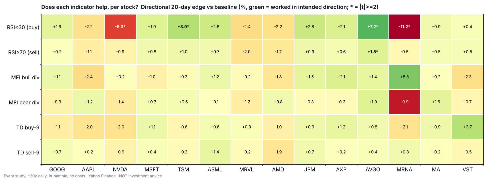
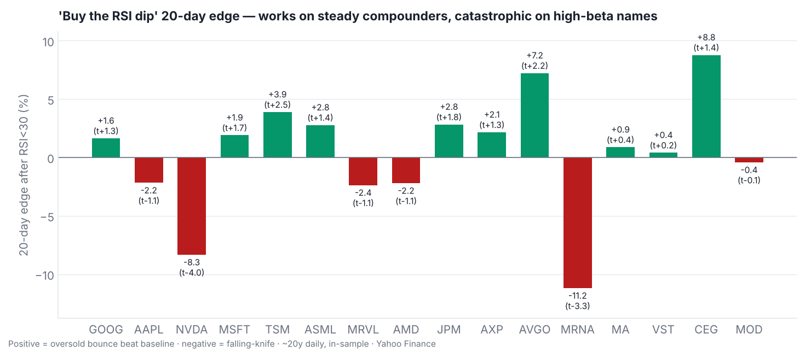
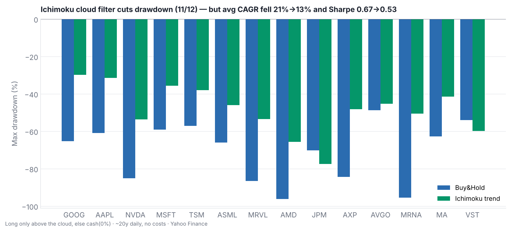

# Technical Indicators — Run + Backtest Across All Tickers

Four indicators — **RSI(14)**, **Money Flow Index(14) divergence**, **Ichimoku**, and **DeMark TD Sequential (9)** — computed for all 16 charted tickers on real daily OHLCV (Yahoo Finance, ~20 years; AVGO from its 2009 IPO, MA from its 2006 IPO, VST from its 2016 listing, MRNA from its 2018 IPO, CEG from its 2022 spin-off; RVII excluded, no history), and **backtested** to answer one question: *for which stocks, if any, does each indicator actually have an edge?*

> **Read this first.** In-sample, single-path, no costs/taxes/slippage, raw close (small dividend distortion). 96 event tests were run (6 signals × 16 stocks), so ~5 false positives at |t|≥2 are expected by chance. This is exploratory analysis, **not** a validated system and **not** investment advice.

Code: [`indicator_backtest.py`](indicator_backtest.py), [`make_summary_charts.py`](make_summary_charts.py) · Data: [`data/`](data/) · Per-ticker panels: [`charts/`](charts/) (`{TICKER}-indicators.png`).

## How each indicator was tested

- **Event study** (RSI oversold `<30` / overbought `>70`, MFI bullish/bearish divergence, TD buy-setup-9 / sell-setup-9): measure the **forward 20-day return after each first-trigger event** and compare to the stock's unconditional baseline. `edge = conditional mean − baseline`. Bullish signals should show edge > 0; bearish signals edge < 0. A t-stat flags reliability (|t|≥2 marked `*`). No look-ahead — divergences are dated at swing *confirmation*.
- **Trend system** (Ichimoku): long only while yesterday's close is above the cloud, else cash (0%); compare CAGR / max drawdown / Sharpe vs buy-and-hold.

## The one-look answer

Green = the signal worked in its intended direction; `*` = |t| ≥ 2. The top row (RSI oversold) is the only one carrying real signal — and the key point is that it is **strongly green for the steady names and deep red for the high-beta ones**. Everything below it is mostly noise.

## Current snapshot (latest session, 2026-10-09 close)

| Stock | Close | RSI | MFI | vs Cloud | Tenkan/Kijun | TD setup |
|-------|------:|----:|----:|----------|--------------|----------|
| GOOG | $347.86 | 56 | 62 | in cloud | bullish | sell-6 |
| AAPL | $336.64 | 56 | 60 | above | bullish | sell-5 |
| NVDA | $229.28 | 53 | 62 | above | bullish | buy-2 |
| MSFT | $535.07 | 67 | 76 | above | bullish | sell-6 |
| TSM | $453.31 | 52 | 64 | above | bullish | buy-2 |
| ASML | $1780.34 | 52 | 46 | above | bullish | buy-3 |
| MRVL | $275.28 | 61 | 60 | above | bullish | **sell-9** |
| AMD | $608.10 | 57 | 55 | above | bullish | buy-2 |
| JPM | $332.99 | **38** | **28** | below | bearish | sell-1 |
| AXP | $308.17 | 43 | 46 | below | bearish | sell-4 |
| AVGO | $361.54 | 50 | 50 | below | bullish | buy-1 |
| MRNA | $225.00 | **72** | 71 | above | bullish | sell-3 |
| MA | $589.14 | 65 | 51 | above | bearish | sell-5 |
| **VST** | $161.48 | 64 | 55 | above | bearish | **sell-9** |
| **CEG** | $298.07 | 62 | 53 | above | bearish | sell-5 |
| **MOD** | $181.56 | 45 | 60 | below | bearish | buy-1 |

Six weeks on from the prior snapshot the picture has rotated. The semis and MRNA ran: **AMD** $466 → $608, **MRVL** $217 → $275 (now with a **completed TD sell-9**), and **MRNA** reversed its August fade entirely, $138 → $225, back to RSI 72 above the cloud — a reminder that on that name the indicators describe the ride, they do not time it. **MSFT** is still the warmest large-cap (RSI 67, MFI 76). The weak spots are the financials: **JPM** and **AXP** are both below their clouds with bearish Tenkan/Kijun, and JPM carries the lowest RSI (38) and money flow (28) in the set — mechanically the set-up where its own RSI-oversold history (+2.8% edge) says to pay attention, though RSI has not reached 30. **VST** enters the table after its 17% October jump: above the cloud and RSI 64, but with a **completed TD sell-9** (nine straight closes above the close four bars earlier) and a Tenkan still below Kijun — a textbook "sharp rally into resistance" print rather than an established uptrend. **CEG** shows the same shape after its 12% Google-deal day: back above the cloud with RSI 62, but Tenkan still under Kijun. **MOD** is the only new name in a confirmed downtrend — below its cloud, bearish Tenkan/Kijun, RSI 45, and 41% below its June high.

## RSI — the only indicator with a real edge, and it is entirely conditional

"Buy the RSI-oversold dip," 20-day forward edge vs baseline:

| Works (steadier names) | Edge | t | Backfires (high-beta) | Edge | t |
|------------------------|-----:|---:|----------------------|-----:|---:|
| AVGO | **+7.2%** | +2.2* | MRNA | **-11.2%** | **-3.3*** |
| TSM | **+3.9%** | +2.5* | NVDA | **-8.3%** | **-4.0*** |
| JPM | +2.8% | +1.8 | MRVL | -2.4% | -1.1 |
| ASML | +2.8% | +1.4 | AAPL | -2.2% | -1.1 |
| AXP | +2.1% | +1.3 | AMD | -2.2% | -1.1 |
| MSFT | +1.9% | +1.7 | | | |
| GOOG | +1.6% | +1.3 | | | |
| MA | +0.9% | +0.4 | | | |
| VST | +0.4% | +0.2 | | | |
| CEG | +8.8% | +1.4 (n=7) | MOD | -0.4% | -0.1 |

**The split is the finding.** RSI mean-reversion worked on the steadier compounders (10 of 16 positive; TSM and AVGO significant) and was **actively destructive on the high-beta names**: MRNA (-11.2%, t -3.3) and NVDA (-8.3%, t -4.0) are the two worst, both statistically significant. On those names "oversold" meant *falling knife*, not bounce — MRNA in particular spent years grinding down from its 2021 peak, and every oversold reading on the way down was another leg lower (its edge got *worse* this run because its recent surge lifted the unconditional baseline the signal is measured against). **VST and MOD are the genuine coin-flips**: VST had 23 oversold events, a 48% hit rate and +0.4% edge; MOD had 81 events (the most in the set), a 42% hit rate and -0.4% edge — neither the compounder pattern nor the falling-knife pattern. CEG's +8.8% looks impressive but rests on 7 events in under five years (t 1.4) and should be ignored until there is a sample. RSI *overbought* as a sell signal was weak everywhere (only AVGO significant at -1.8%, t -2.3) and backfired on momentum names, which stay overbought while they climb.

**Adding MRNA flipped the pooled result — and that is the honest headline.** With 11 winners the pooled oversold edge was mildly positive (+0.25%); adding one big decliner turned it slightly **negative (-0.10%, now -0.02% with Mastercard, Vistra, Constellation and Modine included)**. There is no *general* dip-buying edge in this data. The edge exists only conditionally, per stock character, and the two tails nearly cancel in aggregate.

## MFI divergence, TD Sequential 9 — no standalone edge

Pooled across all 16 stocks (20-day forward edge vs baseline):

| Signal | Events | Edge | Hit rate | t | Useful? |
|--------|-------:|-----:|---------:|---:|---------|
| RSI oversold (buy) | 646 | **-0.02%** | 59% | -0.0 | only per-stock (see above) |
| RSI overbought (sell) | 1603 | +0.04% | 59% | +0.1 | no (wrong sign) |
| MFI bullish divergence | 573 | +0.64% | 58% | +0.9 | no |
| MFI bearish divergence | 865 | -0.09% | 59% | -0.2 | no |
| TD buy-setup 9 | 735 | -0.27% | 58% | -0.6 | no (wrong sign) |
| TD sell-setup 9 | 1193 | +0.03% | 60% | +0.1 | no (wrong sign) |

- **MFI divergence** still shows no reliable pooled edge, and *bearish* divergence has pointed the wrong way on most names — most spectacularly on **MRNA (+9.9%**, n=17, t 1.2): flagging "distribution" right before a doubling. The one genuine exception remains **MA, where bearish divergence was followed by -1.6% underperformance (n=78, t -1.9)** — the correct sign and the closest any MFI signal comes to significance in this study. One near-miss out of 16 is what chance looks like, so treat it as a lead to test out-of-sample rather than a finding. On VST, MFI bullish divergence pointed the *wrong* way (-2.3%, t -0.9); on MOD it pointed the right way (+3.0%) but with a 48% hit rate and t 0.6.
- **TD Sequential 9** marks plausible exhaustion points on the charts but produced no significant 20-day forward edge on any stock (pooled ≈ 0). The best single reading in the set is still **VST's buy-setup 9 (+3.7%, n=22, hit 68%, t 1.5)** — the right sign, but on 22 events and short of significance it is exactly the kind of result 96 tests will produce by chance. MOD's sell-setup 9 pointed the wrong way (+2.3%, t 1.2) and CEG's buy-9 did too (-4.1% on 7 events). Useful as context/confluence at best, not as a standalone timing signal.

## Ichimoku — a drawdown tool, and MRNA is its best case

Long only above the cloud, else cash:

| | Avg CAGR | Avg max drawdown | Avg Sharpe |
|--|--------:|-----------------:|-----------:|
| Buy & Hold | 23.4% | -71.2% | 0.71 |
| Ichimoku trend | 13.4% | -49.8% | 0.55 |

The cloud filter cut max drawdown in **13 of 16** names (avg -71% → -50%) but gave up roughly **40% of the CAGR** (23% → 13%), beating buy-and-hold on Sharpe in only 3 of 16. Those three are the tell:

| Stock | Buy & Hold (CAGR / MaxDD / Sharpe) | Ichimoku | Why it worked (or didn't) |
|-------|-----------------------------------|----------|---------------------------|
| **MRNA** | 37.6% / -95.4% / 0.70 | **42.7% / -50.6% / 0.93** | Parabolic COVID run then a 95% collapse — the filter sat out most of the collapse |
| **AMD** | 15.2% / -96.2% / 0.53 | 17.9% / -65.6% / 0.62 | One of the two deepest crashers in the set |
| **MOD** | 8.6% / -97.6% / 0.44 | **19.2% / -55.6% / 0.65** | The other: Modine's 2008-09 near-bankruptcy — the filter sat out most of it and more than doubled the CAGR |
| MA (counter-example) | 26.9% / -62.8% / 0.90 | 14.4% / -41.4% / 0.70 | Steady compounder — the filter cut drawdown but cost 12 points of CAGR |
| **VST (counter-example)** | 26.4% / -54.0% / 0.77 | **8.3% / -59.8% / 0.42** | Fast V-shaped corrections — the filter sold near each bottom, re-bought higher, and made drawdown *worse* while cutting CAGR by two-thirds |
| **CEG (counter-example)** | **51.6% / -50.8% / 1.09** | 14.5% / -64.5% / 0.56 | The highest-Sharpe stock in the set; the filter gave up 37 points of CAGR *and* deepened the drawdown |

That pattern is consistent and economically sensible: **trend filters pay only when the crash you avoid is catastrophic.** MRNA (-95%), AMD (-96%) and MOD (-98%) are the three worst buy-and-hold drawdowns, and they are the only three wins. **Mastercard is the clean counter-example**: a high-Sharpe compounder where the filter halved drawdown but cost 12 points of CAGR and 0.20 of Sharpe. **Vistra is the harsher one**: with ten years of sharp, quickly-recovered drops, the cloud filter was out of the stock for 44% of the time and still ended up with a *deeper* worst drawdown than simply holding. **CEG** is harsher still: since its 2022 listing it has compounded at 52% a year with a 1.09 Sharpe, and the cloud filter turned that into 14.5% with a *deeper* drawdown. **JPM** remains the original whipsaw casualty (drawdown got *worse*, -70% → -78%). Same lesson as the SMA-200 test in [`../backtests/`](../backtests/) — where MRNA is an even more dramatic case (CAGR 37.6% → 70.4%) and VST's trailing stop also deepened its drawdown: trend filters buy insurance, not alpha, and the insurance is only worth the premium on collapse-prone names.

## Verdict — for which stocks are these useful?

| Indicator | Useful on… | Not useful / harmful on… |
|-----------|-----------|--------------------------|
| **RSI oversold (dip-buy)** | Steadier compounders: **TSM, AVGO** (significant), JPM, MSFT, ASML, AXP, GOOG, MA (CEG positive but on 7 events) | High-beta / collapse-prone: **MRNA, NVDA** (both significantly harmful), AMD, MRVL, AAPL. Neutral (coin-flip) on VST, MOD |
| **RSI overbought (sell)** | Marginally AVGO only | Everyone else; backfires on momentum names |
| **MFI divergence** | None reliably (MA's bearish divergence is the lone near-miss, t -1.9) | All others (bearish divergence often points the wrong way — see MRNA) |
| **TD Sequential 9** | None reliably (standalone; VST's buy-9 at t 1.5 is the best single reading) | All 16 |
| **Ichimoku trend** | Drawdown insurance on most names; risk-adjusted win only on **MRNA, AMD, MOD** (the deepest crashers) | Costs meaningful return on the other 13; makes drawdown *worse* on JPM, VST and CEG |

**Bottom line:** across these 16 names there is **no general-purpose technical edge**. The one real signal — RSI-oversold dip-buying — is entirely conditional on the stock's character: reliably positive on lower-beta compounders, significantly *destructive* on parabolic/collapse-prone names where trend-continuation dominates mean-reversion, and a coin-flip on fast, volatile movers like VST and MOD. The pooled edge is ~zero precisely because those groups cancel. MFI divergence and TD Sequential 9 show no standalone forward-return edge on any of these stocks. Ichimoku is a drawdown reducer whose cost is only justified where drawdowns are catastrophic (MRNA, AMD, MOD), and it actively backfires on whipsaw-prone names (JPM, VST, CEG). **Match the tool to the stock, or don't use the tool.**

## Caveats

In-sample, single historical path, 16 hand-picked large caps (15 long-run winners plus MRNA as the one decliner; MOD adds a near-bankruptcy survivor — better than an all-winners sample, but still not representative), no costs/taxes/slippage, raw close, single (daily) timeframe, and 96 event tests (multiple-comparisons risk). MRNA's own sample is small (18 oversold events, 17 bearish divergences) VST has only ten years of history (23 oversold events, 22 TD buy-9s) and CEG under five (7 oversold events), so their extremes are suggestive rather than settled. Indicators are mechanical and lagging and say nothing about fundamentals. **Not investment advice.**
