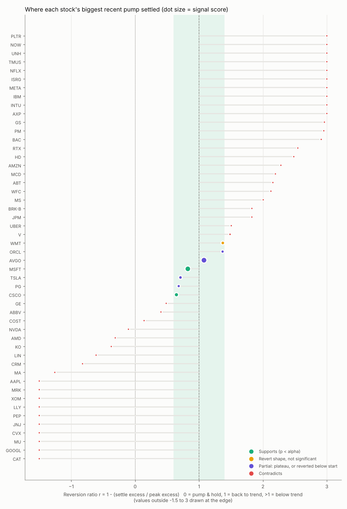

# Pump-and-revert-to-trend: results

Data through **2026-10-29**, 3.0y daily history, raw adjusted price, 200 bootstrap nulls per stock, alpha = 0.1.

## Aggregate

- Stocks analysed: 50; best recent episode found for 50
- Settled within ±0.4 of trend (|r−1| small): **7** observed vs 5.4 expected from random paths (p = 0.286)
- ...of which individually significant (p < alpha): **5** vs 5.0 by chance (p = 0.576)
- Strict SUPPORTS (real fall, settled above start, significant): **2**; PARTIAL: 4
- Median reversion ratio r: 1.37 (hypothesis predicts ~1)
- Peak months of the in-band episodes: {'2024-12': 1, '2025-08': 1, '2025-09': 1, '2025-10': 1, '2026-02': 1, '2026-03': 1, '2026-05': 1} (clustering = a shared market event, so stocks are not independent tests)

## Per stock (sorted by signal score)

| Ticker | Verdict | Shape | Score | p | r | Pump vs trend | Peak -> settle | Settle vs trend | Settle vs start | Start -> Peak -> Settle |
|---|---|---|---:|---:|---:|---:|---:|---:|---:|---|
| [AVGO](charts/AVGO.png) | PARTIAL | plateau_trend_catchup | 60 | 0.015 | 1.08 | +38% | +7% | -7% | +89% | 2025-04-28 -> 2025-10-02 -> 2026-10-05 |
| [MSFT](charts/MSFT.png) | SUPPORTS | pump_revert | 57 | 0.030 | 0.82 | +38% | -27% | +10% | +13% | 2025-04-17 -> 2025-08-07 -> 2026-04-29 |
| [CSCO](charts/CSCO.png) | SUPPORTS | pump_revert | 27 | 0.090 | 0.65 | +42% | -11% | +12% | +18% | 2026-04-30 -> 2026-05-21 -> 2026-09-23 |
| [WMT](charts/WMT.png) | WEAK (not distinguishable from noise) | pump_revert | 17 | 0.104 | 1.37 | +20% | -16% | -9% | +3% | 2025-11-12 -> 2026-03-03 -> 2026-08-28 |
| [TSLA](charts/TSLA.png) | PARTIAL | pump_revert_below_start | 16 | 0.080 | 0.71 | +118% | -41% | +7% | -11% | 2024-10-25 -> 2024-12-17 -> 2025-03-11 |
| [ORCL](charts/ORCL.png) | PARTIAL | pump_revert_below_start | 11 | 0.095 | 1.37 | +72% | -49% | -17% | -1% | 2025-05-19 -> 2025-09-29 -> 2026-02-04 |
| [PG](charts/PG.png) | PARTIAL | pump_revert_below_start | 11 | 0.149 | 0.68 | +19% | -12% | +6% | -0% | 2026-01-22 -> 2026-02-25 -> 2026-03-11 |
| [V](charts/V.png) | CONTRADICTS | crash_below_trend | 2 | 0.154 | 1.49 | +18% | -12% | -12% | +6% | 2024-10-31 -> 2025-05-06 -> 2026-03-30 |
| [NVDA](charts/NVDA.png) | CONTRADICTS | continued_rise | 0 | 1.000 | -0.10 | +42% | +4% | +49% | +37% | 2025-05-30 -> 2025-07-18 -> 2026-01-12 |
| [META](charts/META.png) | CONTRADICTS | crash_below_trend | 0 | 1.000 | 4.91 | +11% | -22% | -35% | +9% | 2025-04-23 -> 2025-07-25 -> 2026-06-15 |
| [JPM](charts/JPM.png) | CONTRADICTS | crash_below_trend | 0 | 1.000 | 1.83 | +11% | +0% | -10% | +18% | 2025-05-09 -> 2025-08-01 -> 2026-03-24 |
| [BRK-B](charts/BRK-B.png) | CONTRADICTS | crash_below_trend | 0 | 1.000 | 1.83 | +11% | -12% | -7% | -3% | 2025-03-11 -> 2025-03-18 -> 2025-06-26 |
| [AMZN](charts/AMZN.png) | CONTRADICTS | crash_below_trend | 0 | 1.000 | 2.28 | +13% | -21% | -12% | -2% | 2024-11-01 -> 2025-02-03 -> 2025-03-24 |
| [LLY](charts/LLY.png) | CONTRADICTS | continued_rise | 0 | 1.000 | -2.15 | +15% | +33% | +49% | +56% | 2025-08-13 -> 2025-10-22 -> 2025-11-26 |
| [MA](charts/MA.png) | CONTRADICTS | continued_rise | 0 | 1.000 | -1.26 | +12% | +10% | +33% | +19% | 2026-07-01 -> 2026-07-13 -> 2026-10-16 |
| [NFLX](charts/NFLX.png) | CONTRADICTS | crash_below_trend | 0 | 1.000 | 6.62 | +17% | -43% | -61% | -15% | 2025-01-14 -> 2025-07-17 -> 2026-07-20 |
| [AAPL](charts/AAPL.png) | CONTRADICTS | continued_rise | 0 | 1.000 | -1.80 | +24% | +32% | +92% | +65% | 2025-07-08 -> 2025-10-15 -> 2026-10-16 |
| [GOOGL](charts/GOOGL.png) | CONTRADICTS | continued_rise | 0 | 1.000 | -5.71 | +11% | +74% | +88% | +90% | 2025-05-06 -> 2025-07-18 -> 2025-12-15 |
| [JNJ](charts/JNJ.png) | CONTRADICTS | continued_rise | 0 | 1.000 | -3.40 | +11% | +41% | +61% | +58% | 2025-07-14 -> 2025-08-08 -> 2026-02-27 |
| [XOM](charts/XOM.png) | CONTRADICTS | continued_rise | 0 | 1.000 | -1.93 | +16% | +32% | +51% | +41% | 2025-06-26 -> 2025-12-24 -> 2026-02-26 |
| [HD](charts/HD.png) | CONTRADICTS | crash_below_trend | 0 | 1.000 | 2.48 | +11% | -16% | -15% | -10% | 2024-11-07 -> 2024-11-14 -> 2025-04-10 |
| [COST](charts/COST.png) | CONTRADICTS | pump_hold | 0 | 1.000 | 0.14 | +13% | -6% | +9% | -3% | 2026-01-28 -> 2026-02-06 -> 2026-07-14 |
| [ABBV](charts/ABBV.png) | CONTRADICTS | partial_revert | 0 | 1.000 | 0.40 | +23% | -6% | +10% | +11% | 2025-07-29 -> 2025-10-03 -> 2026-03-20 |
| [BAC](charts/BAC.png) | CONTRADICTS | crash_below_trend | 0 | 1.000 | 2.91 | +11% | -15% | -15% | -7% | 2024-11-06 -> 2024-11-13 -> 2025-03-24 |
| [AMD](charts/AMD.png) | CONTRADICTS | continued_rise | 0 | 1.000 | -0.31 | +135% | +27% | +222% | +163% | 2025-04-28 -> 2025-10-02 -> 2025-10-20 |
| [PLTR](charts/PLTR.png) | CONTRADICTS | crash_below_trend | 0 | 1.000 | 20.28 | +11% | -24% | -86% | +44% | 2025-04-16 -> 2025-07-07 -> 2026-07-07 |
| [UNH](charts/UNH.png) | CONTRADICTS | crash_below_trend | 0 | 1.000 | 7.24 | +11% | -52% | -45% | -42% | 2025-03-26 -> 2025-04-02 -> 2025-05-21 |
| [GE](charts/GE.png) | CONTRADICTS | partial_revert | 0 | 1.000 | 0.49 | +35% | +11% | +10% | +86% | 2025-04-08 -> 2025-09-23 -> 2026-09-24 |
| [CVX](charts/CVX.png) | CONTRADICTS | continued_rise | 0 | 1.000 | -3.80 | +11% | +43% | +72% | +78% | 2025-04-30 -> 2025-10-29 -> 2026-10-16 |
| [KO](charts/KO.png) | CONTRADICTS | continued_rise | 0 | 1.000 | -0.37 | +14% | +6% | +21% | +16% | 2026-02-12 -> 2026-07-22 -> 2026-08-19 |
| [IBM](charts/IBM.png) | CONTRADICTS | crash_below_trend | 0 | 1.000 | 4.69 | +11% | -15% | -36% | +4% | 2025-01-17 -> 2025-07-22 -> 2026-07-23 |
| [WFC](charts/WFC.png) | CONTRADICTS | crash_below_trend | 0 | 1.000 | 2.12 | +12% | -18% | -10% | -4% | 2025-10-16 -> 2026-01-06 -> 2026-03-24 |
| [MU](charts/MU.png) | CONTRADICTS | continued_rise | 0 | 1.000 | -4.83 | +67% | +733% | +1644% | +877% | 2025-03-27 -> 2025-08-14 -> 2026-07-20 |
| [CAT](charts/CAT.png) | CONTRADICTS | continued_rise | 0 | 1.000 | -8.79 | +11% | +139% | +169% | +174% | 2025-03-20 -> 2025-07-11 -> 2026-05-22 |
| [MS](charts/MS.png) | CONTRADICTS | crash_below_trend | 0 | 1.000 | 2.00 | +14% | -21% | -9% | +2% | 2024-10-25 -> 2025-02-14 -> 2025-03-11 |
| [GS](charts/GS.png) | CONTRADICTS | crash_below_trend | 0 | 1.000 | 2.96 | +11% | -22% | -13% | -2% | 2025-01-14 -> 2025-02-06 -> 2025-03-13 |
| [AXP](charts/AXP.png) | CONTRADICTS | crash_below_trend | 0 | 1.000 | 3.12 | +11% | -22% | -17% | -9% | 2025-01-13 -> 2025-01-21 -> 2025-03-13 |
| [CRM](charts/CRM.png) | CONTRADICTS | continued_rise | 0 | 1.000 | -0.82 | +31% | +24% | +67% | +58% | 2026-07-09 -> 2026-08-24 -> 2026-08-31 |
| [PM](charts/PM.png) | CONTRADICTS | crash_below_trend | 0 | 1.000 | 2.95 | +14% | -16% | -20% | +21% | 2025-01-27 -> 2025-06-10 -> 2025-11-03 |
| [TMUS](charts/TMUS.png) | CONTRADICTS | crash_below_trend | 0 | 1.000 | 6.81 | +11% | -26% | -39% | -5% | 2024-10-25 -> 2025-03-17 -> 2026-03-18 |
| [MRK](charts/MRK.png) | CONTRADICTS | continued_rise | 0 | 1.000 | -1.88 | +34% | +47% | +127% | +61% | 2025-05-19 -> 2025-10-20 -> 2026-02-23 |
| [RTX](charts/RTX.png) | CONTRADICTS | crash_below_trend | 0 | 1.000 | 2.55 | +11% | -15% | -16% | +2% | 2025-12-08 -> 2026-02-10 -> 2026-04-24 |
| [ABT](charts/ABT.png) | CONTRADICTS | crash_below_trend | 0 | 1.000 | 2.16 | +22% | -31% | -30% | -22% | 2024-12-17 -> 2025-06-23 -> 2026-05-11 |
| [MCD](charts/MCD.png) | CONTRADICTS | crash_below_trend | 0 | 1.000 | 2.20 | +11% | -19% | -8% | -10% | 2026-01-29 -> 2026-02-12 -> 2026-06-02 |
| [LIN](charts/LIN.png) | CONTRADICTS | continued_rise | 0 | 1.000 | -0.61 | +12% | +6% | +19% | +11% | 2026-02-02 -> 2026-02-18 -> 2026-05-12 |
| [ISRG](charts/ISRG.png) | CONTRADICTS | crash_below_trend | 0 | 1.000 | 5.77 | +11% | -18% | -38% | -7% | 2024-11-04 -> 2024-11-11 -> 2025-08-20 |
| [PEP](charts/PEP.png) | CONTRADICTS | continued_rise | 0 | 1.000 | -3.31 | +11% | +13% | +54% | +19% | 2025-07-16 -> 2025-07-23 -> 2026-04-02 |
| [UBER](charts/UBER.png) | CONTRADICTS | crash_below_trend | 0 | 1.000 | 1.50 | +30% | -28% | -11% | -2% | 2025-04-09 -> 2025-07-25 -> 2026-07-28 |
| [NOW](charts/NOW.png) | CONTRADICTS | crash_below_trend | 0 | 1.000 | 10.69 | +11% | -56% | -66% | -44% | 2025-04-15 -> 2025-05-30 -> 2026-04-30 |
| [INTU](charts/INTU.png) | CONTRADICTS | crash_below_trend | 0 | 1.000 | 3.42 | +30% | -60% | -53% | -54% | 2025-03-07 -> 2025-09-08 -> 2026-06-30 |

See README.md for the method and column definitions.
