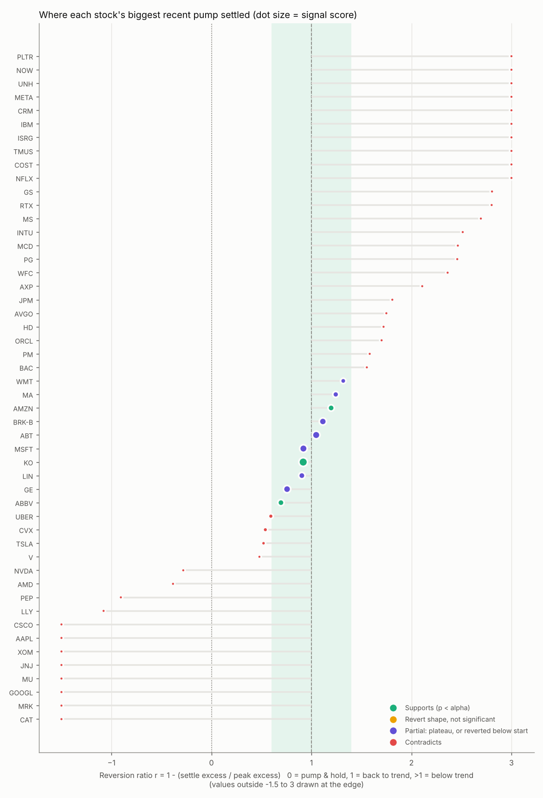

# Pump-and-revert-to-trend: results

Data through **2026-10-29**, 3.0y daily history, price relative to SPY, 200 bootstrap nulls per stock, alpha = 0.1.

## Aggregate

- Stocks analysed: 50; best recent episode found for 50
- Settled within ±0.4 of trend (|r−1| small): **10** observed vs 5.2 expected from random paths (p = 0.031)
- ...of which individually significant (p < alpha): **10** vs 5.0 by chance (p = 0.027)
- Strict SUPPORTS (real fall, settled above start, significant): **3**; PARTIAL: 7
- Median reversion ratio r: 1.28 (hypothesis predicts ~1)
- Peak months of the in-band episodes: {'2025-01': 1, '2025-03': 1, '2025-04': 4, '2025-05': 1, '2025-08': 1, '2025-09': 1, '2026-03': 1} (clustering = a shared market event, so stocks are not independent tests)

## Per stock (sorted by signal score)

| Ticker | Verdict | Shape | Score | p | r | Pump vs trend | Peak -> settle | Settle vs trend | Settle vs start | Start -> Peak -> Settle |
|---|---|---|---:|---:|---:|---:|---:|---:|---:|---|
| [KO](charts/KO.png) | SUPPORTS | pump_revert | 55 | 0.015 | 0.92 | +25% | -21% | +4% | +2% | 2025-02-03 -> 2025-04-10 -> 2025-08-20 |
| [ABT](charts/ABT.png) | PARTIAL | pump_revert_below_start | 40 | 0.015 | 1.05 | +43% | -44% | -16% | -41% | 2024-11-18 -> 2025-05-08 -> 2026-05-11 |
| [MSFT](charts/MSFT.png) | PARTIAL | pump_revert_below_start | 39 | 0.025 | 0.92 | +34% | -35% | +5% | -18% | 2025-03-14 -> 2025-08-05 -> 2026-04-29 |
| [GE](charts/GE.png) | PARTIAL | plateau_trend_catchup | 35 | 0.050 | 0.76 | +29% | -6% | +1% | +17% | 2025-03-12 -> 2025-09-11 -> 2026-09-14 |
| [BRK-B](charts/BRK-B.png) | PARTIAL | pump_revert_below_start | 33 | 0.030 | 1.11 | +28% | -24% | -2% | -5% | 2025-02-07 -> 2025-04-08 -> 2025-07-17 |
| [LIN](charts/LIN.png) | PARTIAL | pump_revert_below_start | 24 | 0.060 | 0.90 | +19% | -23% | -3% | -18% | 2025-02-12 -> 2025-04-03 -> 2025-10-30 |
| [AMZN](charts/AMZN.png) | SUPPORTS | pump_revert | 23 | 0.065 | 1.20 | +11% | -13% | +4% | +4% | 2024-10-29 -> 2025-01-03 -> 2026-01-07 |
| [ABBV](charts/ABBV.png) | SUPPORTS | pump_revert | 23 | 0.055 | 0.69 | +27% | -17% | +7% | +3% | 2025-01-31 -> 2025-03-13 -> 2025-05-15 |
| [MA](charts/MA.png) | PARTIAL | pump_revert_below_start | 19 | 0.050 | 1.24 | +22% | -29% | -6% | -21% | 2024-10-25 -> 2025-04-30 -> 2026-04-24 |
| [WMT](charts/WMT.png) | PARTIAL | pump_revert_below_start | 14 | 0.055 | 1.32 | +24% | -26% | -3% | -7% | 2025-11-26 -> 2026-03-30 -> 2026-07-20 |
| [UBER](charts/UBER.png) | CONTRADICTS | partial_revert | 8 | 0.119 | 0.59 | +50% | -39% | +19% | -18% | 2025-01-16 -> 2025-07-09 -> 2026-07-10 |
| [CVX](charts/CVX.png) | CONTRADICTS | partial_revert | 7 | 0.129 | 0.54 | +51% | -21% | +25% | +17% | 2026-01-06 -> 2026-03-30 -> 2026-04-17 |
| [TSLA](charts/TSLA.png) | CONTRADICTS | partial_revert | 3 | 0.124 | 0.52 | +123% | -37% | +39% | +3% | 2024-10-25 -> 2024-12-18 -> 2025-02-25 |
| [JPM](charts/JPM.png) | CONTRADICTS | crash_below_trend | 0 | 1.000 | 1.81 | +11% | -6% | -8% | +7% | 2024-11-19 -> 2025-05-23 -> 2026-04-23 |
| [NVDA](charts/NVDA.png) | CONTRADICTS | continued_rise | 0 | 1.000 | -0.28 | +28% | +1% | +40% | +22% | 2025-05-30 -> 2025-07-14 -> 2026-05-28 |
| [GOOGL](charts/GOOGL.png) | CONTRADICTS | continued_rise | 0 | 1.000 | -4.78 | +11% | +54% | +72% | +56% | 2025-04-24 -> 2025-08-07 -> 2025-12-19 |
| [META](charts/META.png) | CONTRADICTS | crash_below_trend | 0 | 1.000 | 5.98 | +11% | -35% | -42% | -24% | 2025-04-30 -> 2025-06-12 -> 2026-06-15 |
| [AAPL](charts/AAPL.png) | CONTRADICTS | continued_rise | 0 | 1.000 | -2.16 | +16% | +11% | +66% | +32% | 2025-07-16 -> 2025-10-20 -> 2026-10-16 |
| [JNJ](charts/JNJ.png) | CONTRADICTS | continued_rise | 0 | 1.000 | -4.17 | +12% | +32% | +95% | +45% | 2024-11-21 -> 2025-05-28 -> 2026-03-26 |
| [XOM](charts/XOM.png) | CONTRADICTS | continued_rise | 0 | 1.000 | -2.90 | +11% | +32% | +44% | +31% | 2025-07-21 -> 2026-01-14 -> 2026-02-24 |
| [NFLX](charts/NFLX.png) | CONTRADICTS | crash_below_trend | 0 | 1.000 | 3.64 | +32% | -53% | -53% | -36% | 2024-12-19 -> 2025-06-25 -> 2026-06-26 |
| [V](charts/V.png) | CONTRADICTS | partial_revert | 0 | 1.000 | 0.48 | +38% | -28% | +21% | -5% | 2024-10-25 -> 2025-04-02 -> 2026-03-24 |
| [LLY](charts/LLY.png) | CONTRADICTS | continued_rise | 0 | 1.000 | -1.08 | +37% | +6% | +109% | +62% | 2025-08-13 -> 2025-12-10 -> 2026-10-16 |
| [ORCL](charts/ORCL.png) | CONTRADICTS | crash_below_trend | 0 | 1.000 | 1.70 | +54% | -50% | -26% | -16% | 2025-05-16 -> 2025-09-26 -> 2026-02-05 |
| [AVGO](charts/AVGO.png) | CONTRADICTS | crash_below_trend | 0 | 1.000 | 1.75 | +27% | -10% | -25% | +32% | 2025-04-10 -> 2025-10-10 -> 2026-10-13 |
| [BAC](charts/BAC.png) | CONTRADICTS | crash_below_trend | 0 | 1.000 | 1.55 | +17% | -22% | -9% | -7% | 2026-06-04 -> 2026-08-18 -> 2026-10-16 |
| [UNH](charts/UNH.png) | CONTRADICTS | crash_below_trend | 0 | 1.000 | 6.43 | +12% | -53% | -43% | -37% | 2025-02-28 -> 2025-04-11 -> 2025-05-28 |
| [PG](charts/PG.png) | CONTRADICTS | crash_below_trend | 0 | 1.000 | 2.46 | +11% | -28% | -13% | -20% | 2025-01-28 -> 2025-04-04 -> 2025-10-28 |
| [AMD](charts/AMD.png) | CONTRADICTS | continued_rise | 0 | 1.000 | -0.38 | +117% | +31% | +188% | +94% | 2025-04-02 -> 2025-10-02 -> 2025-10-16 |
| [CSCO](charts/CSCO.png) | CONTRADICTS | continued_rise | 0 | 1.000 | -1.72 | +13% | +23% | +41% | +49% | 2026-01-12 -> 2026-05-07 -> 2026-05-14 |
| [IBM](charts/IBM.png) | CONTRADICTS | crash_below_trend | 0 | 1.000 | 5.33 | +11% | -31% | -37% | -18% | 2025-01-29 -> 2025-07-30 -> 2026-07-31 |
| [COST](charts/COST.png) | CONTRADICTS | crash_below_trend | 0 | 1.000 | 3.71 | +11% | -27% | -20% | -12% | 2025-01-08 -> 2025-04-04 -> 2025-10-16 |
| [PLTR](charts/PLTR.png) | CONTRADICTS | crash_below_trend | 0 | 1.000 | 20.55 | +11% | -36% | -86% | +13% | 2025-04-07 -> 2025-07-01 -> 2026-07-02 |
| [HD](charts/HD.png) | CONTRADICTS | crash_below_trend | 0 | 1.000 | 1.72 | +11% | -17% | -2% | -6% | 2025-08-18 -> 2025-09-08 -> 2025-10-17 |
| [CAT](charts/CAT.png) | CONTRADICTS | continued_rise | 0 | 1.000 | -7.75 | +11% | +97% | +137% | +110% | 2025-02-28 -> 2025-07-31 -> 2026-05-07 |
| [MU](charts/MU.png) | CONTRADICTS | continued_rise | 0 | 1.000 | -4.61 | +65% | +559% | +1546% | +677% | 2025-03-25 -> 2025-08-22 -> 2026-07-02 |
| [WFC](charts/WFC.png) | CONTRADICTS | crash_below_trend | 0 | 1.000 | 2.36 | +11% | -21% | -13% | -12% | 2025-12-02 -> 2025-12-16 -> 2026-04-24 |
| [MS](charts/MS.png) | CONTRADICTS | crash_below_trend | 0 | 1.000 | 2.69 | +11% | -19% | -17% | -8% | 2026-05-13 -> 2026-07-02 -> 2026-10-16 |
| [PM](charts/PM.png) | CONTRADICTS | crash_below_trend | 0 | 1.000 | 1.58 | +34% | -28% | -18% | +4% | 2025-01-28 -> 2025-04-29 -> 2025-10-29 |
| [GS](charts/GS.png) | CONTRADICTS | crash_below_trend | 0 | 1.000 | 2.81 | +11% | -19% | -17% | -11% | 2026-05-29 -> 2026-06-05 -> 2026-09-21 |
| [AXP](charts/AXP.png) | CONTRADICTS | crash_below_trend | 0 | 1.000 | 2.11 | +12% | -21% | -8% | -11% | 2025-09-18 -> 2025-12-29 -> 2026-03-24 |
| [CRM](charts/CRM.png) | CONTRADICTS | crash_below_trend | 0 | 1.000 | 5.84 | +11% | -51% | -39% | -50% | 2024-10-25 -> 2025-04-10 -> 2026-04-14 |
| [RTX](charts/RTX.png) | CONTRADICTS | crash_below_trend | 0 | 1.000 | 2.80 | +11% | -23% | -16% | -13% | 2026-01-12 -> 2026-04-02 -> 2026-04-23 |
| [MRK](charts/MRK.png) | CONTRADICTS | continued_rise | 0 | 1.000 | -5.25 | +13% | +47% | +108% | +11% | 2025-03-31 -> 2025-09-25 -> 2026-03-06 |
| [TMUS](charts/TMUS.png) | CONTRADICTS | crash_below_trend | 0 | 1.000 | 4.25 | +18% | -39% | -44% | -30% | 2025-02-05 -> 2025-03-10 -> 2026-01-06 |
| [MCD](charts/MCD.png) | CONTRADICTS | crash_below_trend | 0 | 1.000 | 2.46 | +13% | -35% | -19% | -32% | 2026-01-28 -> 2026-02-12 -> 2026-09-25 |
| [ISRG](charts/ISRG.png) | CONTRADICTS | crash_below_trend | 0 | 1.000 | 4.77 | +11% | -28% | -38% | -27% | 2024-12-30 -> 2025-01-17 -> 2025-09-16 |
| [PEP](charts/PEP.png) | CONTRADICTS | continued_rise | 0 | 1.000 | -0.91 | +17% | +15% | +35% | +11% | 2025-07-28 -> 2026-01-27 -> 2026-02-05 |
| [NOW](charts/NOW.png) | CONTRADICTS | crash_below_trend | 0 | 1.000 | 10.17 | +11% | -61% | -65% | -63% | 2024-11-06 -> 2025-05-12 -> 2026-05-07 |
| [INTU](charts/INTU.png) | CONTRADICTS | crash_below_trend | 0 | 1.000 | 2.51 | +43% | -68% | -45% | -61% | 2025-01-30 -> 2025-08-01 -> 2026-07-14 |

See README.md for the method and column definitions.
